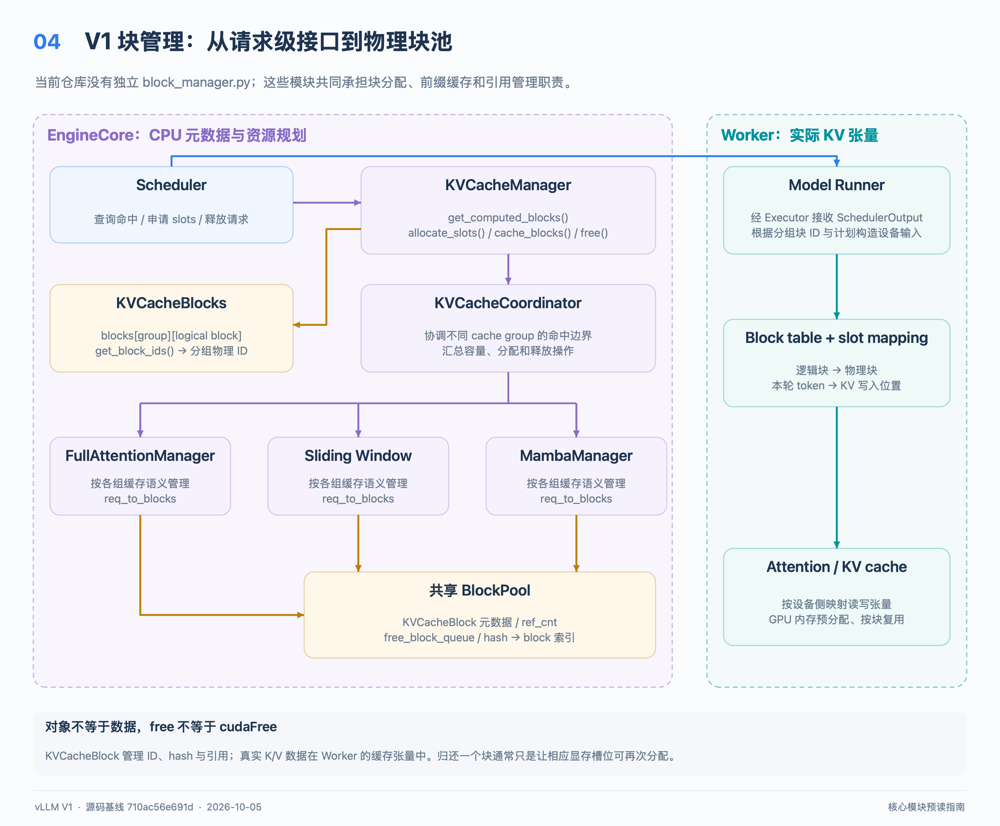
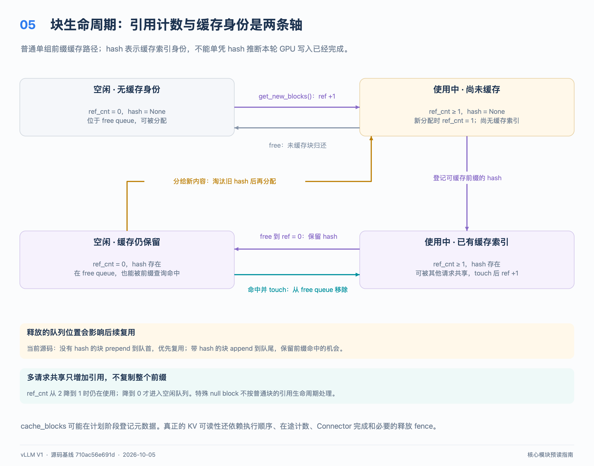
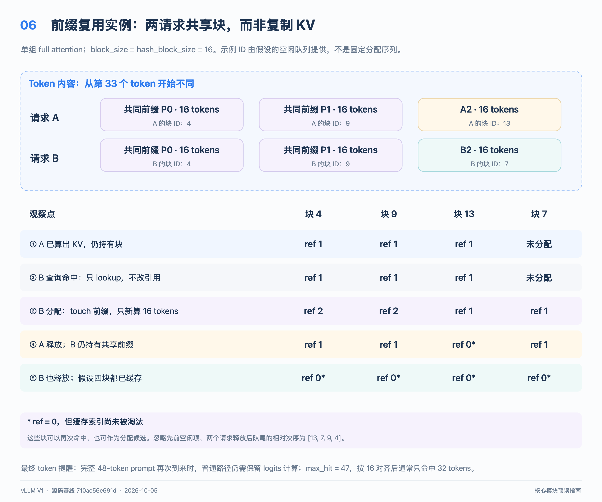

# 从零读懂 vLLM V1 的 KV block 管理

本文面向第一次阅读 vLLM 的开发者：先解释 KV 为什么要分块，再沿一次请求的命中、分配、缓存和释放走进源码。
阅读基准是本仓库提交 `710ac56e691d4713feca50a43e6c440f07d373fd`（2026-10-05）；文末主要源码链接固定到这个提交。
本版本没有 `block_manager.py`。旧文章中的“block manager”职责，主要分布在 `kv_cache_manager.py`、`kv_cache_coordinator.py`、`single_type_kv_cache_manager.py`、`block_pool.py` 和 `kv_cache_utils.py`。
这里以 **V1、单个 full-attention cache group、普通文本请求**建立直觉，然后单独说明 hybrid、部分块命中和异步执行。
想先理解“谁决定这一轮执行哪些 token”，请读[Scheduler 导读](scheduler_guide_zh.md)；想理解“谁计算 K/V”，请读[Llama 模型导读](llama_model_guide_zh.md)。
快速预读路线：先看第 1～5 节建立对象与状态的直觉，再手算第 8 节，最后对照第 6 节跟进 `allocate_slots()`。

配图下载：[全部 9 张高清 PNG](../assets/design/core_modules_guide_zh/core_modules_png.zip)，本文对应图 04～06。

## 1. 先回答：为什么需要 KV block？

自回归模型每生成一个新 token，attention 都要读取历史 token 的 Key 和 Value。
把历史 K/V 留在显存中，就不必每一步重新投影整个历史序列；这部分中间结果称为 KV cache。
KV cache 不保存模型权重，也不等同于原始 token ID、最终回答或 logits。

如果为每个请求预留最大上下文长度的连续显存，短请求会浪费空间，长请求增长时也难以安排。
vLLM 把缓存容量拆成固定大小的分配单位，请求增长时按需取得更多单位，通过 block table 找回自己的历史 K/V。
例如一个请求的三个逻辑块可以映射到物理块 `[4, 9, 13]`，不要求物理编号连续。
若 block size 为 16，40 个 token 需要 `ceil(40 / 16) = 3` 个块，最后一块只用 8 个位置；已有尾块还有空间时，继续追加 token 不必马上取得新块。
多个请求拥有相同前缀时，还可以让它们的块表指向已经存在的缓存块，省下相应的 prefill 计算与容量。

| 术语 | 本文中的具体含义 | 容易混淆的对象 |
| --- | --- | --- |
| token | tokenizer 产生的一个 token ID；不是固定长度的汉字或单词 | 字符、字节 |
| token position | token 在请求序列中的位置，本文从 0 编号 | 物理块 ID |
| 逻辑块／逻辑页 | 请求中一段连续 token 位置，例如 `[16, 32)` | 不必对应独立的 Python“逻辑块”对象 |
| physical block | 池中可分配的缓存容量，使用 `block_id` 标识 | Python 对象本身占用的内存 |
| block size | 一个缓存块覆盖的 token 数 | 显存字节数 |
| page size | 对应缓存存储的字节数，必须说明按层还是按池统计 | 所有模型统一的固定常量 |
| block table | 按请求、cache group 记录“逻辑位置 → 物理块 ID”的映射 | prefix hash 查找表 |

在普通、无 padding、K/V head dimension 相同的 attention 层中，一层一页的大小可写为：
`2 × block_size × num_kv_heads × head_size × 每个元素的字节数`。
前面的 `2` 对应 K 和 V；应使用 KV head 数，而不是直接使用 Query head 数。
这只是建立量级直觉的公式；实际实现由 [AttentionSpec][src-spec] 描述，量化、不同 K/V 维度、padding、压缩状态和并行分片都可能改变布局。
一个 allocator block 对应哪些层或哪些 tensor 页，由 `KVCacheConfig` 和 worker 布局决定，不能把上面的“单层页字节数”直接当作整个模型每块占用。

## 2. 先看职责图，再看类



图中左侧管理“这一块归谁、还能否复用”；右侧才拥有实际缓存 tensor、执行地址映射和 K/V 读写。

| 层次 | 主要入口 | 应当问它的问题 |
| --- | --- | --- |
| Scheduler | `schedule()` | 这一轮给哪个请求多少 token？容量不足时如何处理？ |
| `KVCacheManager` | `get_computed_blocks()`、`allocate_slots()`、`free()` | 请求能复用多少前缀？能否安排本轮所需缓存？ |
| `KVCacheCoordinator` | `find_longest_cache_hit()`、`allocate_new_blocks()` | 多个 cache group 如何达成共同命中长度并一起分配？ |
| `SingleTypeKVCacheManager` 及子类 | `req_to_blocks`、`cache_blocks()` | 某一种 attention／状态缓存需要保留哪些位置？ |
| `BlockPool` | `get_new_blocks()`、`touch()`、`free_blocks()` | 哪些物理 ID 空闲？引用和 hash 索引如何更新？ |
| worker | `initialize_kv_cache_tensors()`、`BlockTable` | 实际 tensor 在哪里？token 应写入哪个 slot？ |

创建协调器的工厂 [get_kv_cache_coordinator()][src-factory] 选择三条路径：关闭 prefix caching、单组缓存、多个组的 hybrid 缓存。
关闭 prefix caching 仍然需要分块分配；“关闭复用”不等于“关闭 KV cache”。
基础 coordinator 创建一个 `BlockPool`，把它交给各组的类型管理器；部分高级机制还存在 host pool 等扩展，不应把基础图当成所有后端的完整拓扑。

## 3. 两个名字相近、意义不同的数据类型

[KVCacheBlock][src-block] 是一个带 slots 的 dataclass，表示池中一个物理块的**管理元数据**。
它没有 K tensor 或 V tensor 字段，也没有直接执行 GPU attention 的方法。

| 字段／属性 | 实际类型 | 阅读时的含义 |
| --- | --- | --- |
| `block_id` | `int` | 当前池内的物理编号 |
| `ref_cnt` | `int` | 当前保留的引用数，初值为 0 |
| `pool` | `BlockPool \| None` | 所属池，支持把跨池的延迟释放交回正确的池 |
| `_block_hash`／`block_hash` | `BlockHashWithGroupId \| None` | 前缀缓存身份；属性只读，内部由专门方法修改 |
| `_block_hash_num_tokens`／`block_hash_num_tokens` | `int \| None` | 此 hash 对应的累计前缀结束位置，不是本块 token 数 |
| `prev_free_block`、`next_free_block` | `KVCacheBlock \| None` | 空闲双向链表指针，只由队列操作 |
| `is_null` | `bool` | 是否是保留的占位块 |

普通路径中，`ref_cnt` 可以理解为持有这个块的请求数；高级路径还会为异步复制等工作保留额外引用，因此它并不永远等于请求数。
池把 ID 0 取出作为 `null_block`，用于被跳过的位置等占位；它不参加普通空闲分配，也不能套用普通块的引用计数规则。

[KVCacheBlocks][src-manager] 则是调度器与管理器之间传递的容器，核心字段为：

```python
blocks: tuple[Sequence[KVCacheBlock], ...]
# blocks[group_index][logical_block_index]
```

外层是 **cache group**，内层才是该组按逻辑位置排列的块；它不是 `list[list[int]]`，也不是把所有层都摊平的一条块链。
`get_block_ids()` 才将其变成 `tuple[list[int], ...]`，供下游传递；空结果可复用预构造的嵌套空 tuple。
同一个 `KVCacheBlock` 对象可能同时出现在两个请求的容器里，这正是普通前缀共享的表示方式。
两组的 block size、保留策略和块数量可能不同，不能假定各组内层长度一致。

## 4. 池内其实维护着三套互相配合的账本

第一套是 `BlockPool.blocks`：按 ID 保存所有物理块元数据，生命周期内可以反复使用同一个对象。
第二套是 `free_block_queue`：由 [FreeKVCacheBlockQueue][src-queue] 维护的双向链表，表示**允许被重新分配**的普通块。
第三套是 `cached_block_hash_to_block`：按前缀身份查找缓存；它可以同时指向正在使用的块和已经空闲的块。
此外，每个类型管理器用 `req_to_blocks[request_id]` 记录请求块表，用 `num_cached_block` 记录该请求的缓存登记进度。

**空闲和已缓存是两个不同的维度。** `ref_cnt == 0` 不表示“显存已经擦除”，也不表示“hash 已经删除”。

| 普通块状态 | `ref_cnt` | 有 hash？ | 在 free queue？ | 之后能做什么 |
| --- | --- | --- | --- | --- |
| 空闲、无缓存身份 | 0 | 否 | 是 | 作为新容量分配 |
| 已分配、尚无缓存身份 | ≥1 | 否 | 否 | 容纳计算／传输；之后可能登记 hash |
| 被持有的缓存块 | ≥1 | 是 | 否 | 其他相同前缀可共享 |
| 空闲但仍缓存 | 0 | 是 | 是 | 命中时重新持有，或在容量压力下被淘汰 |

hash 表不为缓存块自动增加一个“缓存引用”。所以最后一个请求释放后，块完全可以同时出现在 hash 表和 free queue。
`get_num_free_blocks()` 包含这些空闲缓存块；`usage` 衡量池的占用情况，不是当前 GPU allocator 已经向设备申请的字节比例。

## 5. 一块内存的生命周期：先分清五个动作



1. **lookup：查找身份。** `get_cached_block()` 查询 hash 表，返回块对象；单独查询不会增加引用，也不会把块移出空闲队列。
2. **touch：取得持有权。** 对命中块增加引用；若之前引用为 0，先从空闲队列移除，防止被后续新分配覆盖。
3. **allocate：取得新容量。** `get_new_blocks(n)` 从队首取块，删除其旧缓存身份，再把引用从 0 增至 1。
4. **cache：登记可复用身份。** `cache_full_blocks()` 把 token 前缀 hash 与物理块关联；不会因此复制 K/V 或释放请求引用。
5. **free：放弃持有权。** `free_blocks()` 减引用；只有减至 0 的普通块才重回空闲队列，已有 hash 通常保留。

因此“找到一块”与“保住一块”不是同一步；“释放引用”与“淘汰前缀身份”也不是同一步。
[get_new_blocks()][src-new] 中的 eviction 是删除旧索引与元数据，真正覆盖旧字节是之后的 worker 写入。
`evict_blocks()` 还可以主动删除被引用块的 prefix identity，但这不会把 `ref_cnt > 0` 的块变成空闲容量。

当前版本的队列策略要直接看 [free_blocks()][src-free]，不能只读“LRU”三个字：

- 无 hash 的块不能提供 prefix hit，释放时放到**队首**，让它们优先复用；跨批次呈现 LIFO 倾向。
- 有 hash 的块释放时放到**队尾**，让近期释放的缓存保留更久，形成缓存块的 LRU 式淘汰顺序。
- 请求释放按逻辑块**逆序**传入，因此同批释放的缓存中，较深的尾部前缀会先于较浅的公共前缀被再次取走。
- 分配总从队首取；不能把全部空闲块都画成按 ID 排序，也不能声称所有释放都 append。

双向链表允许命中空闲队列中间的块时 O(1) 摘除；`prev_free_block`、`next_free_block` 就为此存在。

## 6. 沿真实入口读一次命中与分配

先打开 [get_computed_blocks()][src-hit]：返回 `(KVCacheBlocks, 命中token数, shared_prefix_boundary)`。
第三项服务于 hybrid 稀疏保留的共享前缀边界；单组普通 full attention 为 0，不应把它读成“新增块数”。
关闭缓存读取，或请求被标记 `skip_reading_prefix_cache` 时，返回空块和 0 命中。
正常查询会把允许的命中上限设为 `request.num_tokens - 1`，保留用于获得 logits 的最后一个 token 的计算。

接着打开 [allocate_slots()][src-allocate]，按以下顺序找对应代码：

1. 汇总请求原有计算进度、本地新命中、外部已计算 token、本轮新增 token，以及 speculative lookahead。
2. 如启用全序列准入检查，先评估整段能否容纳；按配置考虑 watermark 等预留容量。
3. 释放对该 attention 类型已经不需要的位置，例如滑窗之外的块；这里考虑尚未执行完的 token，不能直接使用乐观进度。
4. 让各类型管理器预测需要消耗多少空闲容量，并检查 `reserved_blocks` 与 watermark；不足则返回 `None`。
5. 通过 `allocate_new_computed_blocks()` 接管本地命中，并在需要时为外部 KV 分配接收容量。
6. 为本轮计算及 lookahead 分配尚缺的块，再按规则登记可缓存部分，返回本次新增分配的 `KVCacheBlocks`。

容量检查不仅统计“新建几个块”。一个 `ref_cnt == 0` 的命中块被 touch 后也会退出 free queue，因此同样消耗可用容量。
普通已运行请求已经持有的块则不重复分配；`ceil(所需token数 / block_size)` 减去现有块数，才是继续扩容的基本关系。
由于第 3 步可能已经释放无用块，返回 `None` 不能理解成整个调用“完全没有改变任何元数据”。
coordinator 先 touch **所有组**的本地命中，再给各组分配外部 KV 容量，避免早处理的组把晚处理组尚未保护的命中淘汰掉。

**特别注意执行时序：** 普通 `allocate_slots()` 会在返回前调用 `coordinator.cache_blocks()`；这时本轮 GPU 计算可能还没有执行。
所以源码中的 hash 登记是调度侧元数据动作，不能作为“GPU 已经写完”的独立证明；数据可读性依赖执行顺序及相应同步机制。
登记上限受 `request.num_tokens` 约束，不能把可能被拒绝的 draft token 或单纯预留的 lookahead 全部当成稳定前缀。
外部传输可通过 `delay_cache_blocks=True` 延后登记；后续还存在独立 `cache_blocks()` 调用，不能把登记时机概括成唯一的一条回调。
返回值只描述这次新增的分配；查询完整请求块表应看 `get_blocks()`／`get_block_ids()`。
返回空的 `KVCacheBlocks` 可以表示已有容量足够、不需再分配物理块；它与容量不足的 `None` 不同。

## 7. 前缀 hash 为什么不能只包含当前 16 个 token？

同一段文本接在不同历史后面，attention 计算出的 K/V 可能不同，因此复用必须包含前文身份。
[hash_block_tokens()][src-hash] 的核心可以写成下面的阅读用伪公式：

```text
H0 = hash(NONE_HASH, tokens[0:16], extra_keys_0)
H1 = hash(H0,        tokens[16:32], extra_keys_1)
H2 = hash(H1,        tokens[32:48], extra_keys_2)
lookup_key = pack(H_i, kv_cache_group_id)
```

这里 hash 的是 token 和附加身份信息，不是读取 GPU 上的 K/V 字节来求 hash。
附加项由 `generate_block_hash_extra_keys()` 产生，包括 LoRA、多模态输入身份、prompt embeddings 和可选 `cache_salt`。
salt 在首个 hash 块加入，再经父 hash 链影响后续前缀；不能只比较可见文本就断言两个请求会命中。
`BlockHash` 和 `BlockHashWithGroupId` 都是以 `bytes` 为底层的 `NewType`；后者实际把 group ID 编成四个字节附在 hash 后面。
`get_request_block_hasher()` 按 `hash_block_size` 增量计算已完整的 hash 单位；“有 token hash”不代表“对应物理块已分配或已计算”。

普通 full attention 从开头寻找连续命中的块，第一次缺块便停止；即使较后块的索引仍存在，也不能用它跨过缺失的历史 KV。
缓存不强制把相同 hash 的物理副本合并：[BlockHashToBlockMap][src-map] 允许同一 key 对应多个块，查询取一个现存副本。
相同内容可以在不同执行时机独立算出并留下多个物理副本，所以“hash 一样 ⇒ block ID 必然一样”不成立。

## 8. 手算例子：两个 48-token 请求共享前 32 个 token

假设只有一个 full-attention group，`block_size = hash_block_size = 16`，不开启 speculative decode、外部传输或 context parallel。
用 `P0`、`P1` 表示各 16 个相同的 token，用 `A2`、`B2` 表示从第 33 个 token 起不同的后缀。
请求 A 是 `[P0, P1, A2]`，请求 B 是 `[P0, P1, B2]`；所有附加 hash 身份一致。
下面是 manager 层的持有与释放演示：各请求只分配、计算这 48 个位置，不展开后续 decode；最后分别释放，也可对应此时取消请求。
物理编号是示例，假定当时队列按顺序给出 `4、9、13、7`；新建池的真实初始队列从较小 ID 开始，ID 0 保留。



| 时刻 | A 块表 | B 块表 | refs：4、9、13、7 | 发生什么 |
| --- | --- | --- | --- | --- |
| A 分配并完成这段计算 | `[4,9,13]` | 无 | `1,1,1,0` | 4、9、13 分别对应 `H0`、`H1`、`H2A` |
| B 只查询命中 | 不变 | 尚未接管 | `1,1,1,0` | 找到 4、9，共 32 token，查询本身不加引用 |
| B 接管命中并完成计算 | `[4,9,13]` | `[4,9,7]` | `2,2,1,1` | touch 4、9；新分配 7 存 `B2`，登记 `H2B` |
| 释放 A | 无 | `[4,9,7]` | `1,1,0,1` | 13 入队尾但保留 `H2A`；4、9 仍由 B 持有 |
| 释放 B | 无 | 无 | `0,0,0,0` | 7、9、4 按此顺序入队尾，都仍有 hash |

表中“完成计算”后的数据才用于讲解 K/V 内容；hash 元数据本身可能已经在此前的分配阶段登记。
A、B 同时持有时共占 **4 个**物理块，不是 6 个；每个共享块都容纳该组相关层的前缀缓存，而不是只共享 token ID。
忽略先前就在队列里的其他空闲项，最终新追加的缓存块相对顺序为 `[13, 7, 9, 4]`。
这正好同时体现了“先释放的先淘汰”与“同一请求的尾块先于头块”。

此时若新请求命中 `H0`、`H1`，它可以把 4、9 从队列中摘出，引用由 0 变 1，无需重算对应前缀。
如果没有这样的命中，而无 hash 的空闲容量和更靠前的候选已经耗尽，新分配会先拿到 13，删除 `H2A` 后让它服务别的内容。
因此“请求结束后仍可命中”和“容量不足时允许覆盖”能够同时成立。

再检查一个边界：把原始 A 的 **完整 48-token prompt** 原样重发，即使三个块都还在，也不能直接把 48 token 全记为命中。
`max_cache_hit_length = 47`；本例按 16 对齐，所以最多复用 32 token，最后一块的 16 token 会重新计算，以获得末 token 的 logits。
若新请求是在 A 的 48-token 前缀后再接一个 token，允许的命中上限就可达到 48；这是不同的请求长度条件。

## 9. block ID 怎样变成真正的 GPU 地址？

[GPUModelRunner.initialize_kv_cache_tensors()][src-gpu-init] 在初始化阶段按缓存配置分配并绑定实际 tensor；普通逐请求分块并不是每次都调用 `cudaMalloc`。
worker 的 [BlockTable][src-table] 保存块 ID 的 CPU／GPU buffer，并把本轮请求的映射送给 attention 元数据构建及计算路径。
在单卡、allocation block size 与 kernel block size 相同的普通 attention 情形，位置 `p` 的映射可写为：

```text
logical_block = p // block_size
offset        = p % block_size
physical_id   = block_table[request_row][logical_block]
slot_id       = physical_id * block_size + offset
```

例如 A 的位置 18 落在逻辑块 1，表中 ID 为 9，块内偏移 2，因此 token slot 为 `9 × 16 + 2 = 146`。
slot 是内核使用的索引，不是完整的裸指针；还需要具体层、K/V tensor 的布局、head 维度和 stride 才能定位字节。
`compute_slot_mapping()` 的真实实现还考虑 context parallel；allocation block 可以拆成更小的 kernel blocks，不能在所有配置下照抄上面四行。
Mamba 等状态缓存使用不同寻址语义，`SlotMappingMode.NONE` 表示不构建这种逐 token 的 slot mapping。

## 10. 进阶：hybrid 的“组”为什么不是一层一个池？

一个模型可以混用 full attention、sliding window、chunked local attention、Mamba 状态等缓存类型。
group 把具有相容缓存管理规则的层组织起来；每组由一个类型管理器负责，基础路径共享 allocator pool。
相同前缀 hash 在不同 group 下代表不同的缓存身份，所以查找 key 必须带 `group_id`。
group ID、层号、请求 ID、block ID 是不同坐标；即使 token 边界相同，也不能让两个不同组仅凭 token hash 共享同一份 KV 身份。
同一 pool 的一个 ID 对应一个元数据块；高级 host pool 中出现相同数字 ID 时，更不能跨池直接比较身份。

full attention 通常保留完整历史；sliding window 可释放窗口之外的块并以 null 占位；Mamba 管理的是状态／checkpoint，不是一段普通的逐 token K/V 数组。
[HybridKVCacheCoordinator.find_longest_cache_hit()][src-hybrid] 协调各组可接受的命中长度，必要时缩短候选并重新检查。
最终可跳过多少 token 取决于**所有参与组都能支持的恢复边界**，不是某个 full-attention 组单独报告的最长长度。
`hash_block_size`、每组 `block_size`、`scheduler_block_size`、kernel block size 是不同概念；基础调度对齐使用各组 block size 的共同倍数。
进一步阅读[现有 Hybrid KV Cache Manager 设计文档](hybrid_kv_cache_manager.md)，并以本提交实际实现核对旧示例与细粒度命中行为。

## 11. 进阶：本版本确实有部分块命中与 copy-on-write

入门例子只共享完整的 16-token 块，**不需要 COW**；不要把 COW 画成所有 prefix hit 的必经步骤。
当前 hybrid 实现有受条件限制的细粒度命中：例如 Mamba `align` 组满足条件，且相关管理器支持所需查找粒度时，可使用小于某组物理块的 hash 边界。
这不是“任何半块都可以命中”；要检查 coordinator 的 `enable_partial_hash_hits`、各组支持能力以及 alignment。
[FullAttentionManager][src-full] 可以登记特定 prompt 尾部的部分块边界；并不为物理块内每一个 token 任意建立缓存项。

若请求命中到共享物理块内部，继续写后缀会有覆盖其他引用的风险；管理器为它预留私有块，替换请求块表对应位置，并记录复制任务。
[_apply_cow()][src-cow] 保留源块引用，给目标块额外保留一次引用；`take_kv_cache_block_copies()` 把 ID 对交给调度输出。
worker 实际执行 `copy_kv_cache_blocks_inplace()`；源／目标的临时引用按执行时序释放，而不是看到块表已经替换就立即回收。
`block_hash_num_tokens` 在这里用于区分“当前 hash 到哪个前缀边界”；部分缓存提升到完整块时，还需要更新相关 hash 索引。
不要从这种受控的部分块 COW 推导出本版本拥有旧版所有 sequence fork／beam-search block manager 的接口。

## 12. 并发：CPU 元数据串行，并不等于 GPU 没有在途工作

基础路径由 Scheduler 创建并调用 `KVCacheManager`；EngineCore 的主循环从输入队列取事件，再推进调度和输出处理。
输入／输出 socket 可以有后台线程，但这不表示每个请求线程可以同时修改 `ref_cnt`、hash map 和空闲链表。
这些管理类没有提供通用的加锁分配器接口；阅读时应按 EngineCore／Scheduler 的调用顺序理解其所有权，不要把 Python GIL 当作并发正确性的契约。
异步调度、worker GPU stream 和 KV connector 可以有在途读写，因此“请求从 running 移除”也不总意味着物理块立即可重新利用。
[Scheduler 的延迟释放路径][src-defer] 可以先摘除请求账本，把引用保留到相应 step fence 满足后才交还 pool；COW 端点也有对应保留路径。
普通 `free()` 既不执行 GPU 清零，也不把显存归还 CUDA allocator；需要的 zeroing 和 copy 是 worker 侧另外执行的工作。

## 13. 建议的源码预读顺序与验证材料

第一遍只走表中前五步，能说清“查找不加引用、释放不删 hash”后，再阅读后面的 worker 和高级分支。

| 顺序 | 阅读入口 | 读完应能回答 |
| --- | --- | --- |
| 1 | [KVCacheBlock 与空闲队列][src-block] | 块有哪些状态？队列指针为什么在块对象里？ |
| 2 | [BlockPool 的分配／touch／free][src-new] | 哪一步真的改变持有权？什么时候删除旧 hash？ |
| 3 | [KVCacheBlocks、get_computed_blocks][src-manager] | Scheduler 接收到的是什么？为什么保留最后一个 token？ |
| 4 | [allocate_slots][src-allocate] | 容量预测、接管命中、新分配、登记的顺序是什么？ |
| 5 | [SingleTypeKVCacheManager][src-single]、[FullAttentionManager][src-full] | 请求自己的逻辑块顺序在哪里维护？ |
| 6 | [coordinator 工厂][src-factory]、[hybrid 命中][src-hybrid] | 多组如何协同？哪些条件会改变对齐？ |
| 7 | [worker BlockTable][src-table]、[GPU cache 初始化][src-gpu-init] | 物理 ID 如何映射到实际 tensor？ |

以下测试适合作为可执行规格来**阅读**；本文编写过程中未运行这些测试，也不据此声称 GPU 路径已验证。

- [test_kv_cache_utils.py](../../tests/v1/core/test_kv_cache_utils.py#L678)：看 `test_kv_cache_block`、队列的 append／prepend／popleft，以及 hash extra keys。
- [test_prefix_caching.py](../../tests/v1/core/test_prefix_caching.py#L3031)：看 `test_cache_blocks`、`test_prefill_not_enough_free_blocks_with_computed_blocks`、`test_maybe_evict_cached_block`。
- [test_single_type_kv_cache_manager.py](../../tests/v1/core/test_single_type_kv_cache_manager.py#L824)：看 `test_evictable_cached_blocks_not_double_allocated`，理解空闲命中块的容量计数。
- [test_partial_prefix_cache_hits.py](../../tests/v1/core/prefix_cache/test_partial_prefix_cache_hits.py#L1439)：看 full-attention 部分命中 COW 与目标块初始状态；先理解普通路径再读。
- [test_deferred_block_free.py](../../tests/v1/core/test_deferred_block_free.py#L145)：看在途步骤完成前后，块何时真正回到 pool。

读完后可以自己检查五个判断：`ref_cnt=0` 是否还能 hit；lookup 是否已经持有块；hash 是否等于 GPU 完成证明；分配失败是否完全无副作用；一个 group 是否等于一个 attention 层。
这五题的答案依次是“可以”“不是”“不是”“不是”“不一定”；能沿代码解释原因，就已经具备继续阅读 Scheduler 与 attention 后端的基础。

[src-manager]: https://github.com/vllm-project/vllm/blob/710ac56e691d4713feca50a43e6c440f07d373fd/vllm/v1/core/kv_cache_manager.py#L35
[src-hit]: https://github.com/vllm-project/vllm/blob/710ac56e691d4713feca50a43e6c440f07d373fd/vllm/v1/core/kv_cache_manager.py#L264
[src-allocate]: https://github.com/vllm-project/vllm/blob/710ac56e691d4713feca50a43e6c440f07d373fd/vllm/v1/core/kv_cache_manager.py#L371
[src-block]: https://github.com/vllm-project/vllm/blob/710ac56e691d4713feca50a43e6c440f07d373fd/vllm/v1/core/kv_cache_utils.py#L176
[src-queue]: https://github.com/vllm-project/vllm/blob/710ac56e691d4713feca50a43e6c440f07d373fd/vllm/v1/core/kv_cache_utils.py#L246
[src-hash]: https://github.com/vllm-project/vllm/blob/710ac56e691d4713feca50a43e6c440f07d373fd/vllm/v1/core/kv_cache_utils.py#L684
[src-spec]: https://github.com/vllm-project/vllm/blob/710ac56e691d4713feca50a43e6c440f07d373fd/vllm/v1/kv_cache_interface.py#L487
[src-map]: https://github.com/vllm-project/vllm/blob/710ac56e691d4713feca50a43e6c440f07d373fd/vllm/v1/core/block_pool.py#L35
[src-new]: https://github.com/vllm-project/vllm/blob/710ac56e691d4713feca50a43e6c440f07d373fd/vllm/v1/core/block_pool.py#L669
[src-free]: https://github.com/vllm-project/vllm/blob/710ac56e691d4713feca50a43e6c440f07d373fd/vllm/v1/core/block_pool.py#L777
[src-single]: https://github.com/vllm-project/vllm/blob/710ac56e691d4713feca50a43e6c440f07d373fd/vllm/v1/core/single_type_kv_cache_manager.py#L51
[src-full]: https://github.com/vllm-project/vllm/blob/710ac56e691d4713feca50a43e6c440f07d373fd/vllm/v1/core/single_type_kv_cache_manager.py#L747
[src-cow]: https://github.com/vllm-project/vllm/blob/710ac56e691d4713feca50a43e6c440f07d373fd/vllm/v1/core/single_type_kv_cache_manager.py#L457
[src-factory]: https://github.com/vllm-project/vllm/blob/710ac56e691d4713feca50a43e6c440f07d373fd/vllm/v1/core/kv_cache_coordinator.py#L1018
[src-hybrid]: https://github.com/vllm-project/vllm/blob/710ac56e691d4713feca50a43e6c440f07d373fd/vllm/v1/core/kv_cache_coordinator.py#L846
[src-table]: https://github.com/vllm-project/vllm/blob/710ac56e691d4713feca50a43e6c440f07d373fd/vllm/v1/worker/block_table.py#L57
[src-gpu-init]: https://github.com/vllm-project/vllm/blob/710ac56e691d4713feca50a43e6c440f07d373fd/vllm/v1/worker/gpu_model_runner.py#L7252
[src-defer]: https://github.com/vllm-project/vllm/blob/710ac56e691d4713feca50a43e6c440f07d373fd/vllm/v1/core/sched/scheduler.py#L2711
