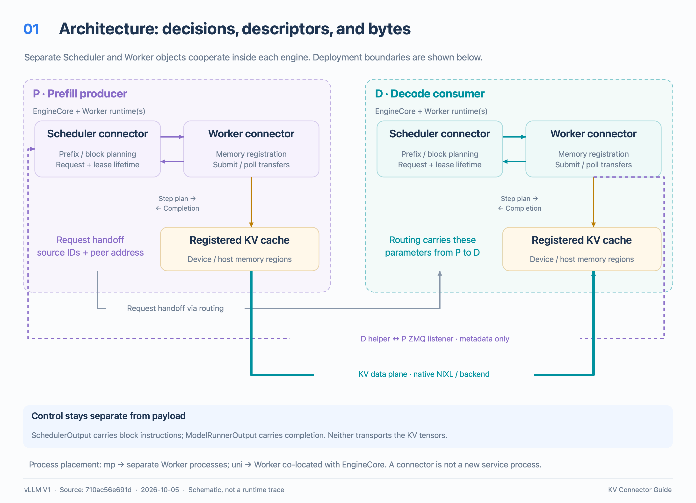
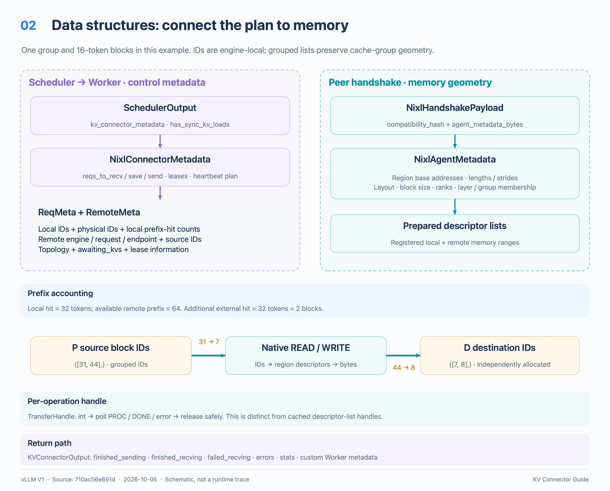
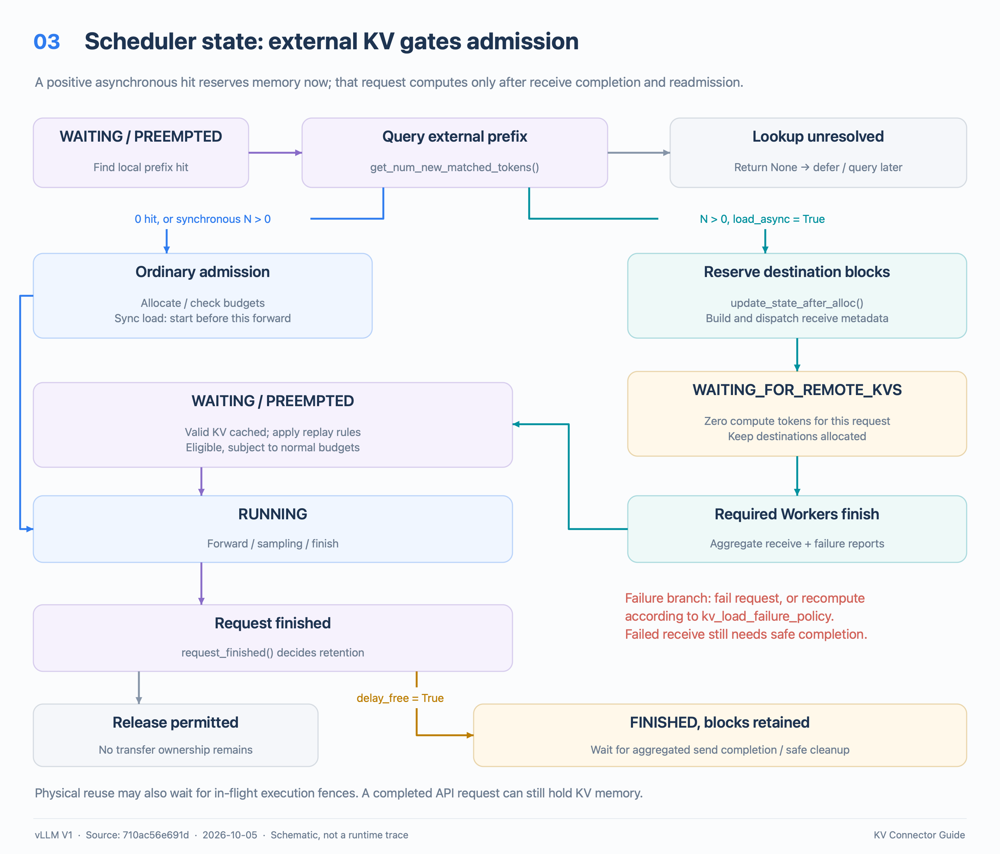
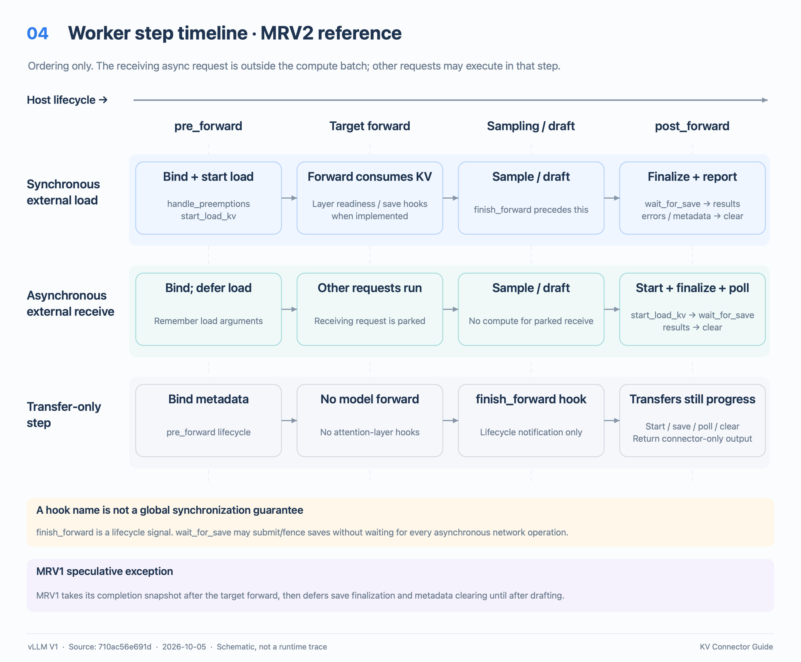
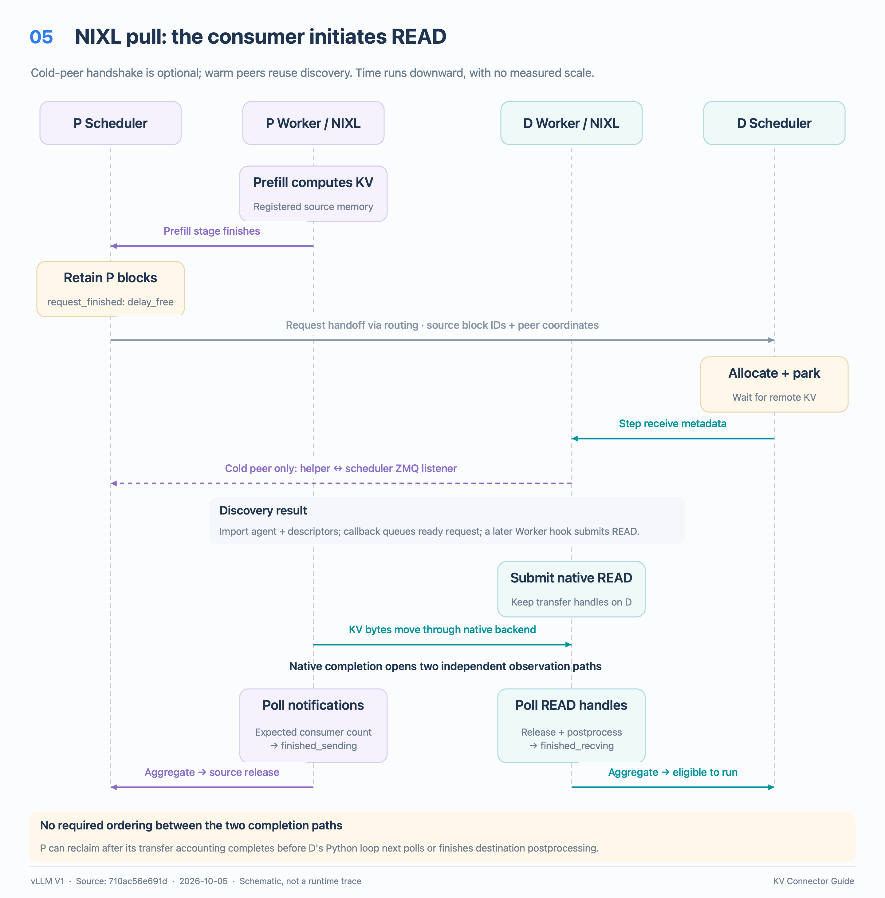
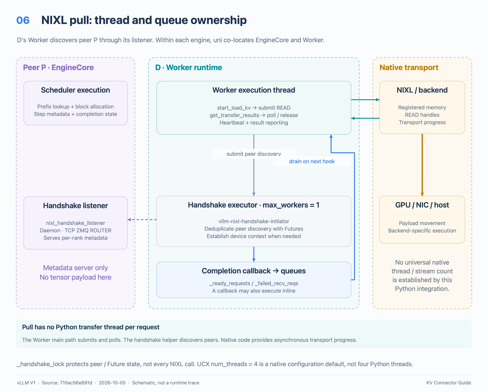
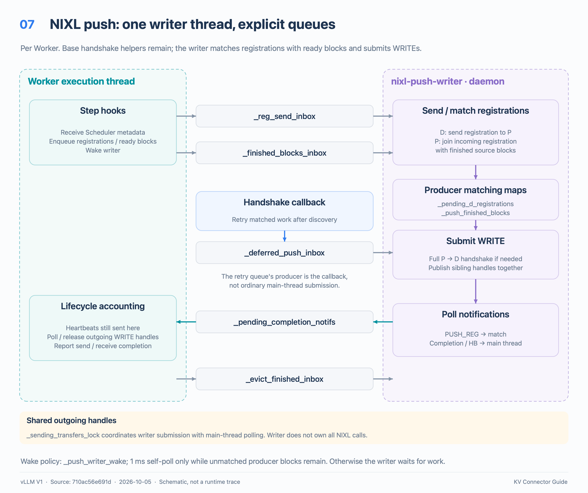
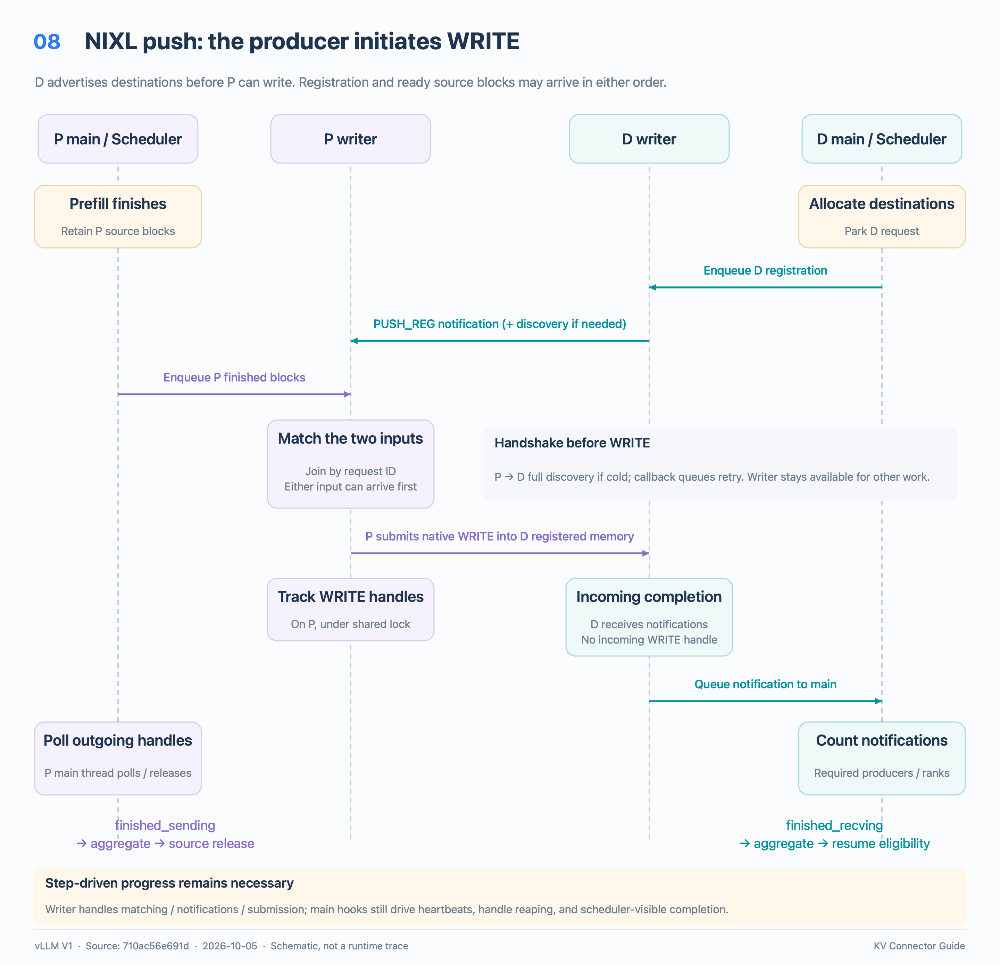
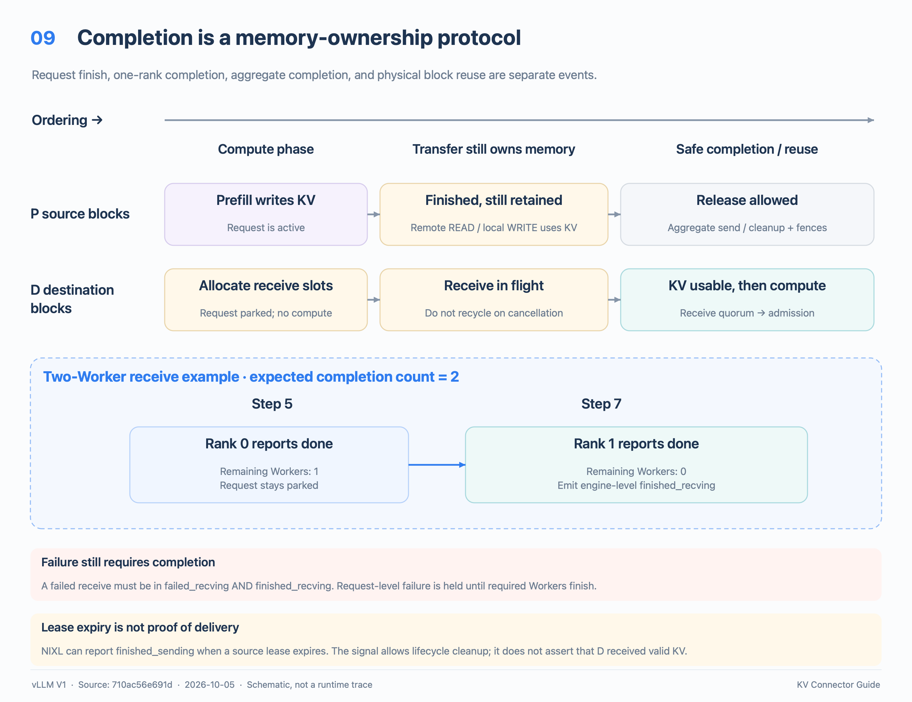

# vLLM KV Connector: architecture, data structures, threads, and timelines

**Source baseline:** vLLM V1, commit [`710ac56e691d`](https://github.com/vllm-project/vllm/tree/710ac56e691d4713feca50a43e6c440f07d373fd), dated 2026-10-05. This guide describes that checkout, not every vLLM release. The connector API is experimental.

**Scope:** the shared V1 connector contract, with **NIXL pull** as the main worked example, **NIXL push** for the different thread/transfer model, and short comparisons with offloading and the example connector. The diagrams are PNGs; their time axes show ordering, not measured latency. P means the prefill producer; D means the decode consumer.

**Downloads:** [all nine PNGs](../assets/design/kv_connector_guide/kv_connector_png.zip). For the surrounding engine, see the [vLLM architecture guide](vllm_architecture_zh.md).

## 1. The ten-minute reading path

1. Read this section and Figure 1: understand **who decides** and **who moves bytes**.
2. Read §3 and Figure 2: follow block IDs from a scheduler plan to registered memory.
3. Read §4–6: follow one asynchronous receive through admission, execution, and completion.
4. Read §7: distinguish the Worker execution thread, handshake helper, and native transport.
5. Read §9: understand why a finished request can still own KV blocks.

A KV connector lets vLLM reuse KV cache outside the ordinary local computation path. It can fetch a prefix produced by another engine, publish locally computed KV, or move KV between GPU memory and an offload tier. Its central job is to connect **token scheduling**, **physical memory placement**, and **transfer lifetime**.

Keep three questions in mind:

| Question | Primary owner | Key API |
|---|---|---|
| How much useful external prefix is available? | Scheduler-side connector | `get_num_new_matched_tokens()` |
| Where should the bytes be loaded or saved? | Scheduler plans blocks; Worker maps them to memory | `update_state_after_alloc()`, `build_connector_meta()`, `start_load_kv()` |
| When may the request run or its blocks be reused? | Worker reports; aggregation and Scheduler decide | `get_transfer_results()`, `request_finished()`, `KVOutputAggregator` |

**The connector is a pair of cooperating implementations, not necessarily a separate service.** One object runs with the Scheduler; another runs in each model Worker. They exchange connector metadata through existing engine/executor machinery. Actual KV bytes use the connector's own storage/transport path.

## 2. Architecture and ownership



### 2.1 Two independent meanings of “role”

| Axis | Values | Meaning |
|---|---|---|
| `KVConnectorRole` | `SCHEDULER`, `WORKER` | Where this Python object runs and which API half it implements. |
| `KVTransferConfig.kv_role` | `kv_producer`, `kv_consumer`, `kv_both` | The deployment's KV production/consumption role. Current NIXL deprecates `kv_both`; do not use it as the default example. |

A prefill producer still has both a scheduler-side connector and Worker-side connectors. So does a decode consumer. With a multiprocessing executor, Scheduler and Workers occupy different processes. With `UniProcExecutor`, a Worker is co-located with EngineCore; the objects and responsibilities remain distinct.

The process-local `get_kv_transfer_group()` accessor returns the Worker connector singleton. Its name does not imply a separate NCCL collective group or a network service.

### 2.2 Three communication paths

| Path | Example contents | Carrier in the NIXL example |
|---|---|---|
| Engine control | Request IDs, grouped block IDs, loads/saves to submit, completion sets | `SchedulerOutput` and `ModelRunnerOutput` through the executor |
| Peer discovery | Native agent metadata, memory layout, compatibility hash, rank-specific descriptors | TCP ZeroMQ handshake with a scheduler-side listener |
| KV data and transport notifications | Cache bytes; completion and heartbeat notifications | Native NIXL backend, such as UCX |

The ZeroMQ handshake does **not** carry the KV tensor payload. Conversely, a `KVConnectorMetadata` object is not a copy of GPU cache tensors. A routing layer can pass request-level transfer parameters from P to D, but request routing itself is outside the connector's core responsibilities.

### 2.3 Startup sequence

1. EngineCore constructs its executor and Workers, then determines and initializes the KV cache configuration.
2. Each Worker initializes its own connector. The engine ID is coordinated across participating TP/PP ranks. Once cache tensors exist, the model runner calls `register_kv_caches(layer_name_to_tensor)`; NIXL registers memory and prepares descriptor lists.
3. After Worker/cache initialization, EngineCore constructs Scheduler. `KVConnectorFactory` creates the Scheduler-side connector, and Scheduler binds its KV cache manager.
4. Workers export handshake metadata. EngineCore gathers it by `(pp_rank, tp_rank)` and passes it to the scheduler connector.
5. NIXL starts its scheduler-side handshake listener. Peer discovery can then occur on demand.

Sources: [factory](../../vllm/distributed/kv_transfer/kv_connector/factory.py), [Worker connector state](../../vllm/distributed/kv_transfer/kv_transfer_state.py), [EngineCore initialization](../../vllm/v1/engine/core.py), [NIXL base scheduler](../../vllm/distributed/kv_transfer/kv_connector/v1/nixl/base_scheduler.py).

## 3. Data structures: from a token prefix to memory bytes



### 3.1 Shared interface types

| Type / field | Direction or owner | What it represents |
|---|---|---|
| `KVConnectorMetadata` | Scheduler → Worker | Abstract base for a concrete per-step transfer plan. |
| `SchedulerOutput.kv_connector_metadata` | Engine dispatch | The plan attached to this execution step. |
| `SchedulerOutput.has_sync_kv_loads` | Engine dispatch | At least one scheduled forward needs externally loaded KV in this step. Controls when loads start. |
| `SchedulerOutput.finished_req_ids` | Engine dispatch | Requests whose compute/request lifecycle finished; these are **not** transfer completion IDs. |
| `KVConnectorHandshakeMetadata` | Peer discovery | Serializable discovery information, separately exchanged from step metadata. |
| `KVConnectorWorkerMetadata` | Worker → Scheduler | Optional connector-specific return state; defines `aggregate(other)` across Workers. |
| `KVConnectorTransferResults` | Worker-local snapshot | `finished_sending`, `finished_recving`, and `failed_recving`, all sets of request IDs. |
| `KVConnectorOutput` | Worker → executor → Scheduler | Completion sets, failures, custom metadata, statistics, events, and expected completion count. |

`SchedulerOutput.kv_connector_block_state` is a special **scheduler-only** planning aid with a lazy block resolver and boundary-state offers. It is cleared before dispatch. The Scheduler's cache manager and lazy callables are not transported as Worker metadata.

### 3.2 NIXL request and step metadata

The following is an abridged type map, not a replacement implementation:

```text
ReqId = str
EngineId = str
TransferHandle = int
BlockIds = tuple[list[int], ...] | list[list[int]]
             └── one block-ID list per KV cache group

RemoteMeta
  block_ids: BlockIds
  host: str, port: int
  engine_id: str, request_id: str
  blocks_expiry_time: float | None
  num_tokens: int | None

ReqMeta
  local_block_ids: BlockIds
  local_physical_block_ids: BlockIds
  local_num_computed_blocks: tuple[int, ...]
  tp_size: int, dcp_size: int, pp_size: int
  remote: RemoteMeta | None
  remote_block_size: int | None
  awaiting_kvs: bool
  region_blocks_to_zero: BlockIds | None

NixlConnectorMetadata
  reqs_to_recv: dict[ReqId, ReqMeta]
  reqs_to_save: dict[ReqId, ReqMeta]
  reqs_to_send: dict[ReqId, float]       # source lease deadlines
  scheduler_clock: float               # reference for deadline rebasing
  reqs_in_batch: set[ReqId]
  reqs_not_processed: set[ReqId]
  heartbeat_by_engine: dict[EngineId, HeartbeatInfo]
  push_registrations: dict[ReqId, dict]
  push_finished_blocks: dict[ReqId, BlockIds]
```

`awaiting_kvs` distinguishes a request actually parked for reception from notify-only work. For example, D may have a full local cache hit but still need to tell P to release its source blocks. Reporting an ordinary receive completion for a request that was never parked would be incorrect.

`local_num_computed_blocks` preserves per-group local-hit information. `local_physical_block_ids` is needed because a logical cache block can expand to multiple physical/kernel pages. Cache-group IDs, TP/PP/DCP topology, and layout all participate in the final mapping; block IDs alone are insufficient.

### 3.3 Memory registration and transfer handles

| Structure | Important fields | Lifetime / purpose |
|---|---|---|
| `NixlAgentMetadata` | Engine ID; native `agent_metadata`; cache base addresses; device; region block counts; `block_lens`; `block_strides`; layout; block size; backend; group/region membership | Describes registered cache regions and their geometry. `block_stride` can exceed the bytes actually transferred per block. |
| `NixlHandshakePayload` | `compatibility_hash`, `agent_metadata_bytes` | Envelope checked before decoding the embedded agent metadata. |
| Prepared descriptor-list handles | Local/remote memory-region descriptions | Cached for registered memory and discovered peers. |
| Per-operation `TransferHandle` | Integer returned for a READ/WRITE operation | Polled until completed or safely released; distinct from a descriptor-list handle. |
| `ReadSpec` / `TPMapping` | Remote ranks, block plans, head slots, notification counts | Map a logical transfer onto participating ranks and memory descriptors. |

The handshake compatibility hash covers model/cache/connector compatibility, including **pull versus push**. TP size, block size, and layout also undergo runtime validation so supported heterogeneous configurations can work. This does not imply arbitrary combinations are supported.

### 3.4 A small concrete example

Assume a simple full-attention cache, one group, equal block sizes of 16 tokens, and supported matching layouts:

```text
Local prefix hit:          32 tokens
Available remote prefix:  64 tokens
Additional external KV:   64 - 32 = 32 tokens = 2 blocks

P source blocks for those 32 tokens:       ([31, 44],)
D newly allocated destination blocks:     ([7, 8],)

P block 31 -> D block 7
P block 44 -> D block 8
```

The numeric IDs are local to each engine; grouped lists preserve cache-group placement and transfer geometry. D does not allocate block 31 merely because P used block 31. Workers translate the planned IDs to registered-memory descriptors; NIXL transfers bytes into D's allocated locations. For one simple region, an address is conceptually `base + block_id × block_stride`, but real descriptors additionally encode region, rank, layout, page expansion, and payload length.

This example deliberately omits hybrid state, partial-tail copying, heterogeneous block sizes, and prefix replay. If all prompt tokens become cached, Scheduler may still replay a final token to produce logits.

Sources: [base types and contracts](../../vllm/distributed/kv_transfer/kv_connector/v1/base.py), [SchedulerOutput](../../vllm/v1/core/sched/output.py), [KVConnectorOutput](../../vllm/v1/outputs.py), [NIXL metadata](../../vllm/distributed/kv_transfer/kv_connector/v1/nixl/metadata.py), [TP mapping](../../vllm/distributed/kv_transfer/kv_connector/v1/nixl/tp_mapping.py).

## 4. Scheduler contract and request states



### 4.1 Prefix lookup is a query, not transfer submission

After finding local prefix hits, Scheduler calls:

```text
get_num_new_matched_tokens(request, num_computed_tokens)
    -> (additional_external_tokens_or_none, load_async)
```

| Result | Meaning |
|---|---|
| `(None, …)` | Lookup unresolved; defer the request and query again. No receive is admitted yet. |
| `(0, False)` | No additional external hit; use ordinary scheduling. |
| `(N > 0, False)` | The scheduled forward consumes these loaded tokens; start loading before that forward. |
| `(N > 0, True)` | Reserve destinations, park the request, and complete reception across steps before computing it. |

The count is additional tokens beyond the supplied local boundary, not total remote tokens or bytes. The query may be repeated and should be side-effect free. Here “async” describes **scheduler admission across steps**; it does not merely mean a CUDA copy uses an asynchronous API.

### 4.2 Allocation and metadata construction

After successful block allocation, Scheduler calls:

```text
update_state_after_alloc(request, actual_request_blocks, num_external_tokens)
build_connector_meta(scheduler_output) -> concrete KVConnectorMetadata
```

For asynchronous loading, this request receives **zero compute tokens** and enters `WAITING_FOR_REMOTE_KVS`. Its destination blocks remain allocated. Other requests may run in the same engine step. Prospective `num_computed_tokens` is recorded for bookkeeping, but it does not mean the bytes are ready to read.

`update_state_after_alloc()` can run again after reception when additional compute slots are allocated. A connector must use `num_external_tokens > 0` to recognize a selected load; nonempty block lists alone are insufficient, including with `MultiConnector`.

`build_connector_meta()` consumes connector planning state and produces instructions. Its contract says not to mutate the supplied `SchedulerOutput`; it must not ship the scheduler-only lazy block resolver.

### 4.3 Completion and return to scheduling

1. Workers report receive completion through `KVConnectorOutput`.
2. The executor aggregates the required Worker reports.
3. Scheduler records `finished_recving` and processes any failure information.
4. At a later scheduling opportunity, `_handle_blocked_waiting_request()` promotes the request to `WAITING`, or `PREEMPTED` if it had previously been preempted.
5. Valid received KV can enter the prefix cache. Final-token/prefix-replay adjustments are applied.
6. Normal token and block budgets decide when it enters `RUNNING`.

Receive completion therefore means **eligible to resume**, not “decoding must start immediately.”

### 4.4 Request finish and block ownership

`request_finished(request, block_ids)` returns `(delay_free, transfer_params)`. Hybrid-aware connectors use `request_finished_all_groups()` instead. The hook runs once before request blocks are freed.

If `delay_free` is true, Scheduler retains the finished request and its blocks. Completion of text generation is separate from completion of connector use. Aggregated `finished_sending` later allows those retained blocks to be freed. Cancellation during an in-flight receive similarly cannot recycle destination blocks until reception reaches a safe completion point.

Sources: [Scheduler admission and lifecycle](../../vllm/v1/core/sched/scheduler.py), especially `schedule()`, `_free_request()`, `_connector_finished()`, `_update_waiting_for_remote_kv()`, and `_update_from_kv_xfer_finished()`; [connector contract](../../vllm/distributed/kv_transfer/kv_connector/v1/base.py).

## 5. Worker hook timeline: when transfer work actually happens



### 5.1 MRV2 reference sequence

The current `ActiveKVConnector` adapter implements:

```text
pre_forward(scheduler_output)
  handle_preemptions(metadata)
  bind_connector_metadata(metadata)
  if has_sync_kv_loads:
    start_load_kv(...)

target model forward
  optional per-layer connector integration:
    wait_for_layer_load(layer)
    attention(layer)
    save_kv_layer(layer, ...)

finish_forward()
sampling / optional draft-model forward

post_forward(finished_req_ids)
  if load submission was deferred:
    start_load_kv(...)
  wait_for_save()
  get_transfer_results(finished_req_ids)
  collect invalid blocks, stats, events, worker metadata
  clear_connector_metadata()
```

With synchronous external loads, the scheduled forward needs that KV, so loads start before forward. With asynchronous receives, the receiving requests are parked outside the compute batch; MRV2 submits their loads in `post_forward()`, after the target/sampling/drafting path. This keeps submission work off the current target forward's host critical path. Actual overlap depends on backend, GPU work, and when progress is observed; this diagram makes no performance promise.

`finish_forward()` is a lifecycle notification, not a guarantee that all device activity or transfers have completed. `wait_for_layer_load()` expresses readiness/ordering; it need not be a CPU-blocking wait. `wait_for_save()` finalizes submission or required synchronization, and is **not universally a wait for all asynchronous network transfers**. An implementation that returns while a save still reads source blocks must retain/protect them.

Whole-cache connectors such as NIXL can leave layer hooks as no-ops. Layerwise connectors must also account for CUDA graph execution: ordinary Python hooks do not automatically execute inside a replayed full graph. The API has `requires_piecewise_for_cudagraph()` for connectors that need appropriate execution boundaries.

### 5.2 Empty compute batches still perform connector work

A step with zero scheduled compute tokens may need to submit receives, dispatch saves, propagate finished IDs, poll progress, or return errors. MRV2 uses `pre_forward → finish_forward → post_forward` without a model forward. MRV1 has its own connector-only path. `wait_for_save()` must tolerate such a step.

Retained requests and `has_pending_push_work()` can keep the engine stepping after ordinary compute work has ended. A transfer-only step is part of normal progress, not an anomalous empty batch.

### 5.3 MRV1 differs in its speculative path

Do not apply the MRV2 sequence literally to all runners. MRV1's context manager submits a deferred load after the target forward and collects its completion snapshot there. With speculative decoding, it defers `wait_for_save()` and metadata clearing until after drafting. MRV1 also calls the preemption hook earlier in `execute_model()` and does not explicitly call the newer `finish_forward()` hook.

Sources: [MRV2 adapter](../../vllm/v1/worker/gpu/kv_connector.py), [MRV2 runner](../../vllm/v1/worker/gpu/model_runner.py), [MRV1 mixin](../../vllm/v1/worker/kv_connector_model_runner_mixin.py), [MRV1 runner](../../vllm/v1/worker/gpu_model_runner.py), [attention hooks](../../vllm/model_executor/layers/attention/kv_transfer_utils.py).

## 6. NIXL pull: one request from prefill to decode

At this baseline, `NixlConnector` is an alias of **`NixlPullConnector`**. The consumer submits native READ operations against registered producer memory.



1. **P computes prefill.** Its request finishes the producer stage. The scheduler connector returns transfer parameters and delays freeing the computed source blocks.
2. **The handoff reaches D.** Parameters identify P's engine, request, host/port, grouped block IDs, token count, topology, and transfer mode. The optional expiry field is `None` in the ordinary P→D handoff; an actual expiry is exported for the bidirectional readback path. This is a control descriptor, not the KV payload.
3. **D reserves destinations.** Its connector advertises an asynchronous external hit. Scheduler allocates local blocks, records the receive plan, and parks the request in `WAITING_FOR_REMOTE_KVS`.
4. **D Worker receives step metadata.** `start_load_kv()` converts logical block IDs to physical pages and records receive state.
5. **Discover P if needed.** D schedules a handshake using its single-worker executor. The helper contacts P's scheduler-side listener, verifies the compatibility envelope, imports the native agent, and prepares remote descriptors. A completion callback publishes a ready request to a queue. A later Worker hook drains that queue. Warm, registered peers skip this discovery work.
6. **D submits READs.** For each required rank/region mapping, it prepares a READ using local and remote descriptor IDs, attaches a producer completion notification, calls NIXL `transfer(handle)`, and retains the handle under the D request ID.
7. **The native backend moves KV bytes.** Python does not synchronously shuttle tensor payloads through the handshake socket.
8. **D observes local completion.** Worker hooks poll transfer handles. `PROC` stays in flight; `DONE` leads to handle release. Required host-to-device staging, layout/block-size conversion, or region cleanup occurs before receive completion is reported.
9. **D resumes through Scheduler.** After the required Workers finish, aggregation emits receive completion. Scheduler makes the request eligible for decoding, subject to normal admission.
10. **P releases its sources.** P independently polls native notifications and waits for its expected consumer notifications. Its Workers report `finished_sending`; aggregation then allows P Scheduler to free the retained blocks.

Steps 9 and 10 have **no universal ordering**. P can observe native READ completion before D's Python loop next polls or completes destination postprocessing. For mixed-memory reads, the implementation defers the notification until all component reads complete.

There are two distinct counting boundaries: a P Worker may need notifications from several consumers under heterogeneous TP mapping; separately, each engine aggregates completion reports across its own required Workers.

Sources: [pull scheduler](../../vllm/distributed/kv_transfer/kv_connector/v1/nixl/pull_scheduler.py), [pull Worker](../../vllm/distributed/kv_transfer/kv_connector/v1/nixl/pull_worker.py), [base Worker handshake and completion](../../vllm/distributed/kv_transfer/kv_connector/v1/nixl/base_worker.py), [mode alias](../../vllm/distributed/kv_transfer/kv_connector/v1/nixl/connector.py).

## 7. NIXL pull thread model



| Execution context | Owned work | Coordination |
|---|---|---|
| EngineCore/Scheduler execution | Prefix lookup, allocation, per-step metadata, request states, retained block lifetime | Existing engine/executor communication |
| Scheduler daemon `nixl_handshake_listener` | TCP ZMQ ROUTER; serves pre-encoded metadata for `(pp_rank, tp_rank)` | Shutdown event; metadata initialized after Worker registration |
| Worker execution thread | Lifecycle hooks; READ submission; handle polling/release; heartbeats; completion reporting | Receives step metadata; drains queues |
| Worker `ThreadPoolExecutor(max_workers=1)` | On-demand peer handshakes and registration preparation | Thread prefix `vllm-nixl-handshake-initiator`; Futures and `_handshake_lock` |
| Handshake completion callback | Publish success/failure and queue pending request work | May execute immediately if attached to an already-completed Future; do not assume one fixed callback thread |
| Native NIXL/backend machinery | Transport progress and device/network operations | Native API and handles; not a Python asyncio task per request |

Pull does **not** introduce a Python data-transfer thread per request, or a dedicated Python asyncio loop for moving KV. Its Python main path submits and polls; native transport can progress asynchronously.

### 7.1 Queues and locks worth recognizing

| Field | Type / purpose |
|---|---|
| `_ready_requests` | `Queue[tuple[ReqId, ReqMeta]]`: successful handshake callback → later pull submission on the Worker main path |
| `_failed_recv_reqs` | `Queue[ReqId]`: background failure → main-thread receive bookkeeping |
| `_invalid_block_ids` | `Queue[set[int]]`: invalid blocks → error reporting |
| `_handshake_futures` | Deduplicates in-flight discovery by remote engine |
| `_remote_agents` | Cached discovered peers |
| `_handshake_lock` | `RLock` protecting handshake Futures/peer registration state; not a universal lock around every NIXL call |

The single-worker handshake executor serializes its handshake jobs. Device-backed handshakes establish the appropriate device context on the helper thread. It is not an executor for all request transfers.

The source configures native NIXL `num_threads` with a default of 4 in the UCX-only configuration path. This is a native-library option, **not four Python connector threads**, and is not a portable description of every backend's internal progress topology. This repository also does not establish one universal CUDA-stream count for NIXL. Backend and staging paths determine those details.

Sources: [base scheduler listener](../../vllm/distributed/kv_transfer/kv_connector/v1/nixl/base_scheduler.py), [base Worker queues, handshake, native setup](../../vllm/distributed/kv_transfer/kv_connector/v1/nixl/base_worker.py), [pull submission](../../vllm/distributed/kv_transfer/kv_connector/v1/nixl/pull_worker.py).

## 8. NIXL push: what changes

`NixlPushConnector` reverses who initiates data movement: **P submits WRITE operations into D's registered destinations**. Both peers must use the compatible push mode. It is a different implementation, not a runtime change inside the `NixlConnector` alias.



### 8.1 One extra writer thread per participating Worker

After cache registration, push starts daemon thread `nixl-push-writer`. It owns the registration/finished-block matching maps:

```text
_pending_d_registrations: dict[ReqId, dict[str, Any]]
_push_finished_blocks: dict[ReqId, BlockIds]
```

The D registration and P's completed source blocks can arrive in either order. The writer joins these pieces by request identity, prepares a peer handshake when required, and submits WRITEs once both are available.

| Cross-thread queue | Direction | Contents |
|---|---|---|
| `_reg_send_inbox` | Main path / handshake callback → writer | D registrations to send |
| `_finished_blocks_inbox` | Main path → writer | P source blocks ready for matching |
| `_deferred_push_inbox` | Handshake callback → writer | Matched work ready to retry after peer discovery |
| `_pending_completion_notifs` | Writer → main path | Completion/heartbeat notifications for lifecycle accounting |
| `_evict_finished_inbox` | Main path → writer | Completed or expired request cleanup |

The writer owns native notification polling and registration parsing/matching. Main-thread hooks still send heartbeats, poll/release outgoing WRITE handles, and report scheduler-visible completion. `_sending_transfers_lock` protects shared outgoing handle lists; all sibling handles for a request are published together to avoid premature completion.

`_push_writer_wake` wakes the writer when work arrives. It self-polls every 1 ms **only while unmatched P finished blocks remain**; otherwise it waits for a wakeup. This is not an unconditional busy loop or one thread per request.

### 8.2 Push sequence



1. D reserves destination blocks and hands a registration to its Worker.
2. D's writer performs notification-only discovery of P if needed, then sends `PUSH_REG:` plus encoded registration data.
3. Separately, P finishes prefill and publishes retained source blocks to its writer.
4. P's writer matches registration and finished blocks. Either can arrive first.
5. P performs a full handshake with D when necessary. The callback queues a retry; the writer does not synchronously wait for the network handshake.
6. P's writer submits WRITE operations into D and tracks outgoing handles on P.
7. D's writer receives completion notifications and passes them to its main path. D has **no incoming WRITE handle to poll**; it counts producer notifications and enters the normal receive-completion path.
8. P's main path polls/releases outgoing WRITE handles and reports send completion. Each side's engine independently aggregates completion and updates block/request state.

Push therefore adds background notification handling and submission, but still needs step-driven lifecycle progress. `has_pending_push_work()` helps keep that progress alive.

Sources: [push scheduler](../../vllm/distributed/kv_transfer/kv_connector/v1/nixl/push_scheduler.py), [push Worker](../../vllm/distributed/kv_transfer/kv_connector/v1/nixl/push_worker.py), [existing push design](nixl_kv_push_connector.md).

## 9. Completion, lifetime, leases, and failures



### 9.1 Four events that must remain distinct

| Event | What it proves |
|---|---|
| Request/generation finishes | This stage no longer needs further ordinary compute for the request. |
| One Worker reports transfer completion | That Worker's local transfer accounting reached completion. |
| Required Worker reports are aggregated | The engine has the completion count required for this request. |
| Blocks are physically reusable | Connector ownership and any relevant in-flight execution fences permit reuse. |

`KVOutputAggregator` counts completions across Workers **and across steps**. It does not simply union their completion sets. The expected count defaults to executor world size unless the connector supplies a different count; output metadata can update it.

For example, with two required Workers, rank 0 finishing in step 5 and rank 1 finishing in step 7 emits engine-level completion in step 7. If rank 0 reports a request-level receive failure in step 5, the aggregator retains that failure until receive completion reaches the required count. This prevents early destination reuse while another Worker still transfers.

### 9.2 Leases and heartbeat progress

For ordinary NIXL P→D transfer, P retains source blocks under a lease. The default P lease is 30 seconds in this baseline. D tracks requests early and sends heartbeat notifications from Worker hooks; there is no dedicated Python heartbeat thread. P extends leases when heartbeats arrive.

P may report `finished_sending` after successful notification accounting **or after a lease expires and sources become reclaimable**. Therefore this set is a lifecycle/release signal, not proof of successful end-to-end KV delivery. Lease expiry can invalidate the handoff; late reads must not be assumed safe. Explicit deadline rejection exists for the bidirectional readback path; ordinary pull does not provide an unconditional timestamp check for every late read.

Scheduler deadlines are rebased to Worker-local clocks; peer-clock estimates are used where the protocol needs them. Raw `perf_counter()` values from different engines should not be compared as if they shared a clock. The bidirectional cached-KV path has a different TTL and is outside the ordinary pull timeline here.

### 9.3 Failure reporting and recovery

The configured default `kv_load_failure_policy` is **`"fail"`** at this commit. Setting `"recompute"` requests recovery by local recomputation when supported by the reported state.

| Mechanism | Required behavior |
|---|---|
| `failed_recving: set[ReqId]` | Identify failed receives unambiguously, including hybrid caches. Failed receives must also appear in `finished_recving` when safe completion is reached, so Scheduler can leave its waiting state. |
| `invalid_block_ids: set[int]` | Identify failed external blocks for supported single-group recovery. With multiple cache groups, flat IDs are ambiguous and Scheduler rejects this report. |
| `fail` policy | Finish affected requests with an error while still respecting transfer/block lifetime. |
| `recompute` policy | Rewind to valid state. Request-level failure of a parked receive can reset computed progress to zero; block-specific failure can preserve the longest valid prefix. |
| Handle failure | A failed status alone does not prove DMA has stopped. If release fails, NIXL keeps handles/resources rather than assuming they are safe to recycle. |

Synchronous load errors must be reported in the detecting pass. Asynchronous load errors must be reported no later than the pass reporting receive completion. Badly timed reporting can expose partially written KV to a forward or leave a request parked indefinitely.

### 9.4 Cancellation, preemption, and empty/full hits

- **Cancellation during receive:** mark the request finished, but retain its destinations until the receive reaches safe completion.
- **Producer preemption:** a reliable handoff must not export descriptors for blocks already freed or overwritten. `requires_kv_delivery` affects stale-output handling.
- **Outstanding saves:** `handle_preemptions()` and implementation-specific fences protect source blocks before reuse. Separate engine fences can delay physical block return while earlier work remains in flight.
- **Full local cache hit at D:** no data READ may be needed, but P still needs a release notification. Notify-only metadata must not invent a parked receive.
- **Aborted handoff before allocation:** empty destination metadata can exist solely to notify/release P.

Sources: [output aggregation](../../vllm/distributed/kv_transfer/kv_connector/utils.py), [Scheduler recovery and free paths](../../vllm/v1/core/sched/scheduler.py), [failure policy](../../vllm/config/kv_transfer.py), [base Worker handle/lease logic](../../vllm/distributed/kv_transfer/kv_connector/v1/nixl/base_worker.py), [lease design](nixl_kv_cache_lease.md).

## 10. Which behavior belongs to the interface, and which to a connector?

| Aspect | NIXL pull | NIXL push | OffloadingConnector | ExampleConnector |
|---|---|---|---|---|
| Main use | Disaggregated KV handoff | Producer-initiated disaggregated handoff | GPU ↔ configured offload tier | Small filesystem demonstration |
| Data movement | D submits READ | P submits WRITE | Load/store jobs through configured offload machinery | Synchronous file/tensor operations |
| Transfer metadata | `ReqMeta`, grouped block IDs, peer descriptors | Same family plus D registrations and P finished blocks | `load_jobs`, `store_jobs`, `jobs_to_flush` | Request token IDs, slot mapping, store/load flag |
| Extra Python coordination | Handshake helper and scheduler listener | Pull's base helpers plus writer thread | Depends on selected offload worker/backend | No NIXL-style transfer thread model |
| Save completion accounting | Request-level send lifecycle | Outgoing WRITE handles and request lifecycle | Store job counts/custom Worker metadata and flush fences | Synchronous save path |
| Best learning use | Trace realistic distributed ownership | Learn cross-thread matching and notification handling | Learn job-oriented persistence and safe reuse | Read a compact implementation of the API |

Offloading's `TransferJob` contains `req_id`, `src_spec`, and `dst_spec`. Worker metadata carries `completed_jobs: dict[job_id, count]`; counts aggregate across Workers. Store work can be deferred to the next step, and `jobs_to_flush` protects block reuse. Stores do **not** universally emit `finished_sending`; job accounting is the important completion mechanism there. This is why NIXL's exact lifetime protocol should not be presented as the universal implementation.

The example connector computes a `slot_mapping` from block IDs and token offsets, uses files as its exchange medium, and leaves some hooks as no-ops. It is useful for learning the contract, not a performance model for a production connector.

Sources: [offload metadata](../../vllm/distributed/kv_transfer/kv_connector/v1/offloading/common.py), [offload Worker](../../vllm/distributed/kv_transfer/kv_connector/v1/offloading/worker.py), [example connector](../../vllm/distributed/kv_transfer/kv_connector/v1/example_connector.py).

## 11. Configuration and practical diagnosis

These are the **connector portion** of a configuration, not a complete launch recipe. Model, transport installation, networking, topology, and routing must match the deployment. The source has explicit restrictions for PP, DCP, PCP, hybrid caches, and mixed-memory layouts; check the compatibility documentation before choosing a topology.

Producer, pull mode:

```json
{
  "kv_connector": "NixlConnector",
  "kv_role": "kv_producer"
}
```

Consumer, pull mode with explicit local recomputation policy:

```json
{
  "kv_connector": "NixlConnector",
  "kv_role": "kv_consumer",
  "kv_load_failure_policy": "recompute"
}
```

Use `NixlPushConnector` on both sides for the push implementation. Connector-specific options live under `kv_connector_extra_config`. A custom plugin can use `kv_connector_module_path`; its constructor must accept `(vllm_config, role, kv_cache_config)`.

| Symptom | First boundary to inspect |
|---|---|
| Request remains `WAITING_FOR_REMOTE_KVS` | Did allocation create receive metadata? Did Worker hooks run, including empty steps? Did handshake finish? Are all handles/required Worker completions accounted for? |
| Prefill finishes but blocks remain occupied | `request_finished(delay_free=True)`, producer notifications, leases, completion aggregation, and physical reuse fences |
| First transfer has extra latency | Cold handshake, peer registration, and descriptor preparation; distinguish these from steady-state KV transport |
| One rank finishes but request never resumes | Expected completion count, rank mappings, remaining transfer handles, and failures held until completion |
| Load fails despite a reachable peer | Compatibility hash, engine identity, registered region geometry, layout/topology, source lease validity |
| Corruption after cancellation/preemption | Destination/source ownership, safe handle release, stale outputs, and flush/free fences |
| Push has registration but no WRITE | Writer's two matching maps; request-ID match; finished-block arrival; full P→D handshake; wake/retry queues |
| No compute requests remain, transfer stalls | Retained-request progress and `has_pending_push_work()`; connector-only execution steps |

For performance work, separately measure scheduler admission wait, cold peer discovery, native transfer duration, completion-observation delay, and post-receive admission wait. End-to-end request latency alone cannot identify which boundary is slow. The timelines in this document intentionally contain no invented millisecond measurements.

## 12. Source-reading map and useful tests

| Read in this order | Focus |
|---|---|
| [V1 base API](../../vllm/distributed/kv_transfer/kv_connector/v1/base.py) | Both API halves, async semantics, error timing, lifetime contracts |
| [MRV2 adapter](../../vllm/v1/worker/gpu/kv_connector.py) | A compact view of actual hook order |
| [Scheduler](../../vllm/v1/core/sched/scheduler.py) | Search `get_num_new_matched_tokens`, `WAITING_FOR_REMOTE_KVS`, `_connector_finished`, `_update_from_kv_xfer_finished` |
| [NIXL facade](../../vllm/distributed/kv_transfer/kv_connector/v1/nixl/connector.py) and [metadata](../../vllm/distributed/kv_transfer/kv_connector/v1/nixl/metadata.py) | Mode/role dispatch and concrete structures |
| [Pull scheduler](../../vllm/distributed/kv_transfer/kv_connector/v1/nixl/pull_scheduler.py) | Hit detection, destination planning, producer handoff |
| [Pull Worker](../../vllm/distributed/kv_transfer/kv_connector/v1/nixl/pull_worker.py) | READ submission, descriptor selection, producer notifications |
| [Base Worker](../../vllm/distributed/kv_transfer/kv_connector/v1/nixl/base_worker.py) | `_ensure_handshake`, `_nixl_handshake`, `get_transfer_results`, `_pop_done_transfers`, leases, shutdown |
| [Aggregator](../../vllm/distributed/kv_transfer/kv_connector/utils.py) | Cross-rank/cross-step completion counts |
| [Push Worker](../../vllm/distributed/kv_transfer/kv_connector/v1/nixl/push_worker.py) | Writer queues, matching, WRITE submission, split completion ownership |

Existing tests make good executable reading material:

| Test file | Behavior to study |
|---|---|
| [test_gpu_kv_connector.py](../../tests/v1/worker/test_gpu_kv_connector.py) | Load start phase; no-forward steps start/finalize exactly once |
| [test_kv_connector_lifecycle.py](../../tests/v1/kv_connector/unit/test_kv_connector_lifecycle.py) | Metadata binding/clearing and save finalization |
| [test_output_aggregator.py](../../tests/v1/kv_connector/unit/test_output_aggregator.py) | Completion counts across ranks/steps; failure held until receive completion |
| [test_remote_prefill_lifecycle.py](../../tests/v1/kv_connector/unit/test_remote_prefill_lifecycle.py) | Async admission, wait/resume, final-token handling, memory headroom |
| [test_kv_load_failure_recovery.py](../../tests/v1/kv_connector/unit/test_kv_load_failure_recovery.py) | `fail`/`recompute`, synchronous/asynchronous errors, multi-group rejection |
| [test_nixl_push_connector.py](../../tests/v1/kv_connector/unit/test_nixl_push_connector.py) | Push-specific scheduling, matching, and completion |

Further project documentation: [disaggregated prefill](../features/disagg_prefill.md), [NIXL usage](../features/nixl_connector_usage.md), [NIXL compatibility](../features/nixl_connector_compatibility.md), [KV offloading](../features/kv_offloading_usage.md). The live upstream [disaggregated-prefill page](https://docs.vllm.ai/en/latest/features/disagg_prefill/) and [NIXL usage page](https://docs.vllm.ai/en/latest/features/nixl_connector_usage/) can describe a newer revision than this guide.

**Validation scope:** this is a source-based learning document. No model inference, distributed transfer benchmark, or GPU test run was performed to generate it. The PNGs are schematic explanations of verified source paths; they are not runtime traces.
