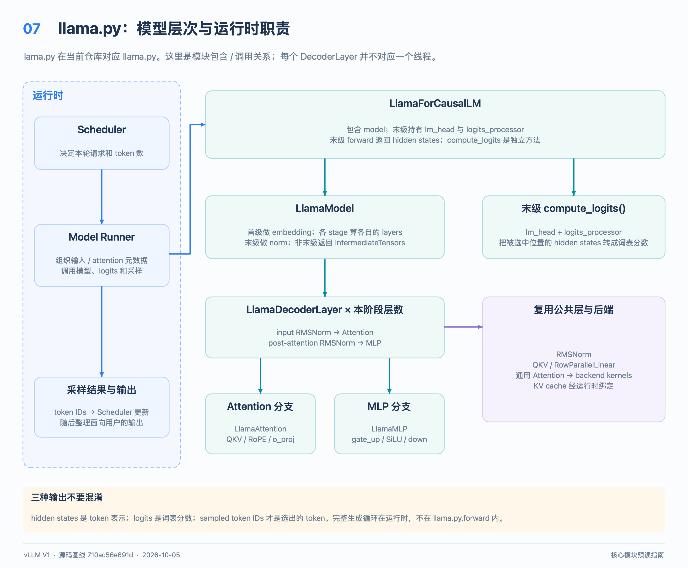
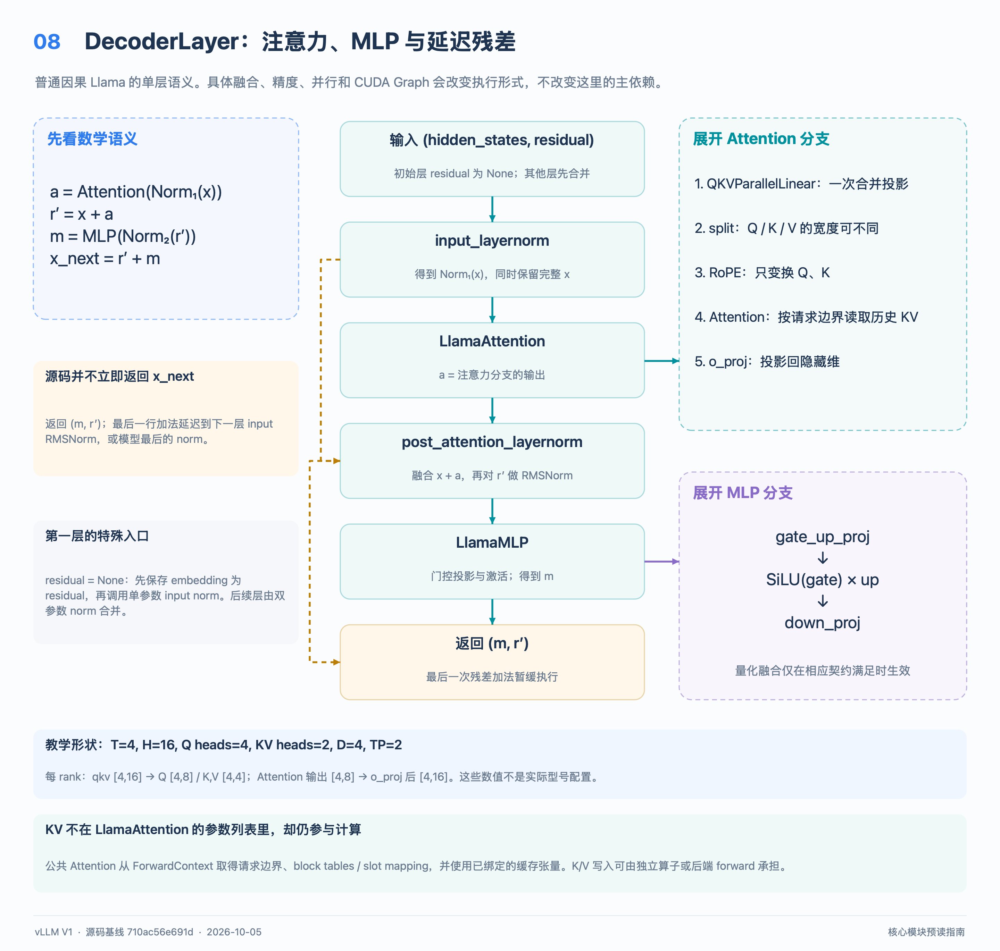
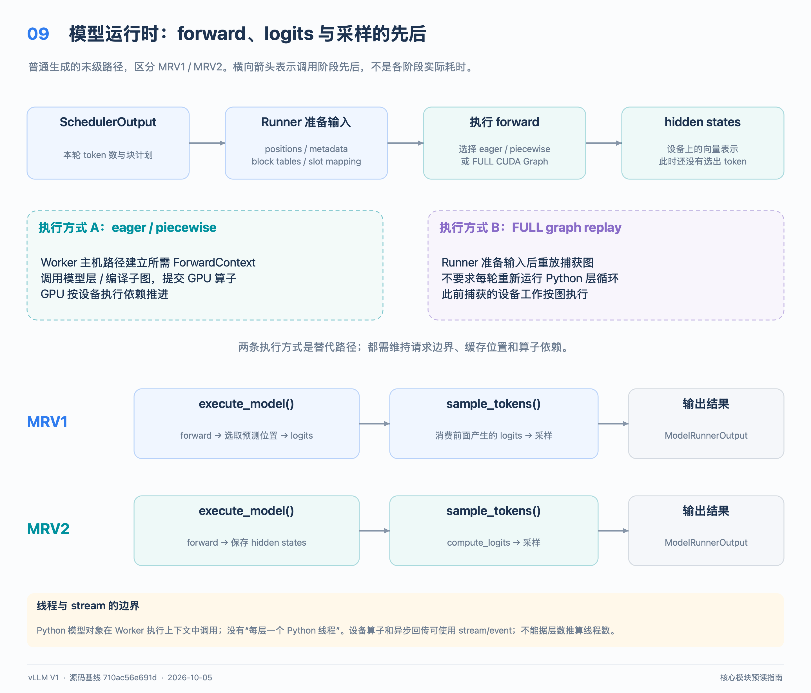

# 从输入 token 到下一步预测：`llama.py` 源码预读指南

本文把问题中的 `lama.py` 对应到实际文件 [`vllm/model_executor/models/llama.py`](../../vllm/model_executor/models/llama.py)。
阅读基准是本地提交 `710ac56e691d4713feca50a43e6c440f07d373fd`（2026-10-05）；类名、调用关系和行号均以此版本为准。
适合知道 Python 类和函数、刚开始接触 Transformer 与 vLLM 的读者；不要求先掌握 CUDA。
主线限定为本文件的普通因果语言模型推理；双向注意力、EAGLE、量化与并行的分支会另外指出。

配图下载：[全部 9 张高清 PNG](../assets/design/core_modules_guide_zh/core_modules_png.zip)，本文对应图 07～09。

## 先用 15 分钟建立阅读地图

| 时间 | 阅读位置 | 要回答的问题 |
| --- | --- | --- |
| 0–3 分钟 | 本文架构图；`LlamaForCausalLM.forward`、`compute_logits` | 模型返回 hidden states，还是已经选好了下一个 token？ |
| 3–6 分钟 | `LlamaModel.forward` | embedding、逐层计算、最终归一化分别在哪里？ |
| 6–9 分钟 | `LlamaDecoderLayer.forward` | `hidden_states` 和 `residual` 为什么一起传？ |
| 9–12 分钟 | `LlamaAttention.forward`、`LlamaMLP.forward` | QKV、RoPE、门控 MLP 的计算顺序是什么？ |
| 12–15 分钟 | 本文运行时图与 KV Cache 一节 | 请求边界和历史 K/V 为什么没有出现在 `llama.py` 的参数里？ |

第一遍先跳过权重加载、EAGLE 辅助输出和编译配置；第二遍再沿本文末尾的源码索引深入。
与它配套的两篇文章是 [Scheduler 指南](scheduler_guide_zh.md)和 [KV Block Manager 指南](kv_block_manager_guide_zh.md)。
前者解释这一轮计算谁、计算多少 token；后者解释缓存空间如何分配、复用和回收。

## 1. 这个文件负责什么

`llama.py` 的文件说明是 “Inference-only LLaMA model compatible with HuggingFace weights”。
它把已加载的权重与本轮输入组合起来，计算每个输入位置的表示，并提供把表示转为词表分数的方法。
它不负责把用户文本分词、不决定请求排队顺序，也不在 `forward` 内执行完整的自回归生成循环。

先区分三个输出：**hidden states** 是 token 的向量表示；**logits** 是各词表项的未归一化分数；**sampled token IDs** 才是选出的 token。
生成多个 token 时，运行时反复调度模型并采样；下一轮通常把上轮选出的 token 作为新的输入位置。
一个 prompt 的最后位置可以预测第一个生成 token，因此“执行 prompt”和“生成第一个 token”不是互相独立的两套模型。



图中父子关系是 Python 模块的包含关系；并不表示每个类对应一个进程、线程或 GPU。

| 模块 | 持有的主要组件 | 主要职责 |
| --- | --- | --- |
| `LlamaForCausalLM` | `model`、末级 PP rank 上的 `lm_head` 与 `logits_processor` | 包装模型；提供独立的 `compute_logits` |
| `LlamaModel` | embedding、decoder layers、最终 RMSNorm | 准备 hidden states，串行经过当前 PP stage 的层 |
| `LlamaDecoderLayer` | 两个 RMSNorm、`self_attn`、`mlp` | 完成注意力分支和 MLP 分支，并携带残差 |
| `LlamaAttention` | `qkv_proj`、RoPE、通用 `Attention`、`o_proj` | 组织 Q/K/V 投影、位置变换与注意力计算 |
| `LlamaMLP` | `gate_up_proj`、`SiluAndMul`、`down_proj` | 对每个 token 的特征做门控非线性变换 |

`Attention`、并行 Linear、RMSNorm 等来自公共层实现；具体算子与 GPU 后端不全部写在这个模型文件里。
因此看到 `self.attn(q, k, v)` 时，应当继续追公共 Attention 层，而不是在 `llama.py` 中寻找完整的 softmax kernel。

## 2. 最少需要认识的术语

| 术语 | 在本文件和运行时中的含义 |
| --- | --- |
| token / token ID | 分词后的单位及其词表编号；不是固定等于一个汉字或单词 |
| embedding | 把 token ID 映射为 `H` 维向量 |
| hidden state | 某个 token 在模型某个位置的中间表示；不是持久 KV Cache |
| Q / K / V | Query、Key、Value；Q 用来与可见 K 匹配，并对相应 V 加权 |
| attention head | 注意力计算的一个通道组；每组向量维数记为 `D` |
| GQA | 多个 Q heads 共享较少的 K/V heads；本文件分别保存两种 head 数 |
| RoPE | 根据位置旋转 Q、K 的部分/全部维度；具体方式由 RoPE 配置决定 |
| RMSNorm | 按向量均方根缩放，并乘可学习权重；区别于减均值的 LayerNorm |
| residual | 跨计算分支保留并相加的表示；这里还承担延迟执行残差相加的角色 |
| prefill / decode | 前者处理尚未计算的 prompt；后者通常处理刚生成的 token |
| TP / PP | Tensor Parallel 切分层内计算；Pipeline Parallel 把不同层交给不同 stage |
| rank / CUDA stream | rank 是分布式参与者的编号；stream 是 GPU 工作的有序提交队列 |

RMSNorm 的概念公式是 `norm(x) = weight * x / sqrt(mean(x²) + eps)`，均值沿隐藏维计算。
本文公式表达计算语义；实际实现可能融合算子、原地更新张量或采用不同精度的中间运算。

## 3. 一次前向：先理解数学，再对齐代码



普通、单 PP stage 的主线如下：

1. `LlamaForCausalLM.forward` 调用 `self.model(...)`。
2. `LlamaModel.forward` 用 `embed_input_ids` 取得 embedding；若提供 `inputs_embeds`，直接使用它。
3. 初始化 `residual = None`，按层号调用 `LlamaDecoderLayer.forward`。
4. 每层依次做输入 RMSNorm、attention、attention 后残差相加与 RMSNorm、MLP。
5. 最后一层后的 `self.norm(hidden_states, residual)` 完成最后一次残差相加与归一化。
6. 返回 hidden states；运行时另行选出需要预测的位置，调用 `compute_logits` 并采样。

### 为什么每层返回两个张量

教科书常把一层写成下面的式子，其中 `x` 是进入这一层的完整表示：

```text
a = Attention(RMSNorm_input(x))
r = x + a
m = MLP(RMSNorm_post(r))
x_next = r + m
```

本实现把最后一行的加法推迟到下一次 RMSNorm，使残差加法与归一化有机会合成一个算子。
因此 `LlamaDecoderLayer.forward` 返回的是 `(m, r)`，不是已经算好的 `(x_next, 任意备份)`。

| 代码位置 | `hidden_states` 的含义 | `residual` 的含义 |
| --- | --- | --- |
| 第一层入口 | embedding，即 `x` | `None` |
| 第一层 input RMSNorm 后 | `RMSNorm_input(x)` | 保存 `x` |
| attention 后 | `a` | 仍是 `x` |
| post-attention RMSNorm 后 | `RMSNorm_post(x + a)` | `r = x + a` |
| MLP 后／层返回 | `m` | `r` |
| 下一层 input RMSNorm 后 | 对 `m + r` 归一化的结果 | `m + r` |

对应代码是：首次 `residual is None` 时先保存输入，再单独调用 RMSNorm；以后调用双参数形式。
公共 [`RMSNorm`](../../vllm/model_executor/layers/layernorm.py) 的双参数路径进入 `ir.ops.fused_add_rms_norm.maybe_inplace`。
其语义是返回“归一化后的和”与“尚未归一化的和”；不要把第二个返回值理解成同一个归一化结果。
末级 stage 的最终 norm 同样接收这两个张量，因此最后一个 MLP 分支的残差不会漏加。
调试时还要注意融合路径可能原地更新：不能仅凭变量名假定所有历史张量都保留着旧值。

### Attention 中的四个步骤

`LlamaAttention.forward` 只有数行，但每一行都有清楚的边界：

1. `qkv, _ = self.qkv_proj(hidden_states)`：用合并投影一次产生 Q、K、V 的输出片段。
2. `qkv.split([q_size, kv_size, kv_size], dim=-1)`：按当前 TP rank 的宽度拆成三个张量。
3. `q, k = self.rotary_emb(positions, q, k)`：位置作用于 Q、K；V 不经过这行 RoPE。
4. `self.attn(q, k, v)` 计算注意力，再由 `o_proj` 投影回隐藏维。

从数学上，可把普通因果注意力理解为 `softmax(Q Kᵀ / sqrt(D) + mask) V`。
这里 K/V 包含当前查询允许访问的历史位置；后端会结合缓存、请求边界和因果限制执行，不要求显式构造一个完整注意力矩阵。
`self.scaling = self.head_dim**-0.5` 正是上述缩放项；`positions` 是序列内位置，不能用扁平 batch 下标代替。
`get_rope` 接收 `head_dim`、`max_position` 和 `config.rope_parameters`，因此不能把所有模型的 RoPE 配置写死为同一个常数。

### MLP 中为什么有 gate 和 up

概念上，`gate = x W_gate`，`up = x W_up`，输出为 `(SiLU(gate) ⊙ up) W_down`。
`gate_up_proj` 合并前两个投影，`SiluAndMul` 对前半激活后与后半逐元素相乘，`down_proj` 回到隐藏维。
源码实际通过 `maybe_fused_act_quant(self.act_fn, x, self.down_proj)` 调用激活：符合下游线性层量化契约时可融合激活与输入量化。
不满足融合条件时回退到普通激活；因此不要把这行解释成“所有 Llama MLP 都会量化”。
此 `LlamaMLP` 构造函数明确拒绝非 `silu` 的 `hidden_act`；其他模型或子类的实现需要另读。

## 4. 张量不是固定的 `[batch, sequence, hidden]`

模型主线接收的是本轮参与计算的 token 的扁平集合；多个请求的片段拼接在 token 维。
记真实 token 数为 `T_actual`，模型输入的 token 维长度为 `T`；CUDA Graph 等路径可能补齐，故 `T ≥ T_actual`。
另记隐藏维为 `H`、MLP 中间维为 `I`、总 Q/KV heads 为 `Nq/Nkv`、TP 大小为 `P`、每头维度为 `D`。
以下是普通 token 布局下每个 TP rank 的逻辑形状，暂不展开 context/sequence parallel 的额外分片：

| 数据 | 形状或宽度 | 解释 |
| --- | --- | --- |
| `input_ids` / `positions` | `[T]` / `[T]` | 一个位置一个 ID 与序列内位置 |
| embedding / layer hidden states | `[T, H]` | 每个 token 的完整隐藏宽度 |
| 本地 Q heads | `nq = Nq / P` | 构造函数检查整除 |
| 本地 KV heads | `nkv = max(1, Nkv / P)` | `Nkv < P` 时是复制 KV heads，不是零个 head |
| packed `qkv` | `[T, (nq + 2*nkv)*D]` | Q、K、V 的宽度不必相同 |
| Q；K/V | `[T, nq*D]`；`[T, nkv*D]` | 通用 Attention 再 reshape 为三维 head 布局 |
| attention 输出 | `[T, nq*D]` | 对应本地 Q heads |
| `o_proj` 输出 | `[T, H]` | RowParallelLinear 默认归约各 rank 的部分结果 |
| `gate_up_proj`；激活后 | `[T, 2*I/P]`；`[T, I/P]` | 假设中间维可按 TP 切分 |
| `down_proj` 输出 | `[T, H]` | 线性层默认执行所需 TP 归约 |

`D` 优先取配置的 `head_dim`；未提供有效值时才使用 `H / Nq`。
常规 GQA 下多个 Q heads 共享一组 K/V heads；源码没有在 `llama.py` 中先把 K/V 展开复制成 Q 的宽度。
总 KV heads 不少于 TP 大小时按 rank 切分；少于 TP 大小时，`QKVParallelLinear` 按复制关系加载 KV heads。
实际缓存张量的维度顺序与打包方式由 attention backend 决定，不能把上表中的临时 K/V 形状当作缓存物理布局。

### 一个可手算的例子

以下参数是教学自选值，**不是任何实际 Llama 型号的配置**：`H=16`、`Nq=4`、`Nkv=2`、`D=4`、`I=32`、`P=2`。
本轮请求 A 处理位置 `0,1,2` 的三个 prompt token，请求 B 处理位置 `7` 的一个 decode token；不考虑补齐。
因此 `T=4`，`positions=[0,1,2,7]`，请求边界可表示为 `query_start_loc=[0,3,4]`。

```text
input_ids [4] → embedding [4,16]
本地 Q heads=2，KV heads=1
qkv [4,16] → Q [4,8]，K [4,4]，V [4,4]
Attention 内部：Q [4,2,4]，K/V [4,1,4]
attention 输出 [4,8] → o_proj + TP 归约 → [4,16]
gate_up [4,32] → SiLU×up [4,16] → down_proj + TP 归约 → [4,16]
```

A 和 B 虽然共享同一批矩阵运算，注意力元数据仍把它们隔开；B 的 Q 不会关注 A 的 prompt。
若 A 的 prompt 到此已处理完，普通生成通常只需要 A 的最后位置和 B 的本轮位置来预测，即两个 logits rows。
这时 logits 的逻辑形状是 `[2, vocab_size]`；不是固定对 `[4,H]` 的所有行生成输出 token。
prompt logprobs、推测解码与采样分片会改变实际选取的行或分布式布局，需要沿 runner 的 `logits_indices` 继续读。

## 5. KV Cache：参数列表之外的运行时状态

`LlamaAttention.forward` 只传入 Q/K/V，不代表没有使用历史缓存。
公共 [`Attention.forward`](../../vllm/model_executor/layers/attention/attention.py) 的说明明确指出：缓存放在 `self.kv_cache`，元数据从 `ForwardContext` 获取。
模型初始化时此缓存是占位张量；运行时分配缓存后，把真实缓存绑定给对应层。

| 信息 | 负责解决的问题 | 与模型的连接 |
| --- | --- | --- |
| block table | 某请求的逻辑块位于哪些物理 KV blocks | runner 组装后端 attention metadata |
| slot mapping | 本轮某个 token 的新 K/V 应写入哪个缓存槽位 | `ForwardContext.slot_mapping` 按层名索引 |
| query/sequence lengths | 哪些 token 属于同一请求、可见上下文有多长 | attention metadata 传给后端 |
| `Attention.kv_cache` | 真正保存 K/V 数据的设备张量 | `get_attention_context` 取得当前层缓存 |

在不考虑 context parallel 等布局变化的块式缓存示例中，位置 `p` 的槽位可写为 `block_table[p // B] * B + p % B`，`B` 是块大小。
这是逻辑寻址示意；具体缓存类型、块表与并行规则请继续阅读 [KV Block Manager 指南](kv_block_manager_guide_zh.md)。
按层分配和绑定的 K/V 含义不同：第 0 层与第 10 层计算出的 K/V 不能因为 token ID 相同就互换。

`get_attention_context(layer_name)` 从 context 取得该层 metadata、层对象、缓存和 slot mapping。
若后端不在 attention forward 中更新缓存，`Attention.forward` 先调用 `unified_kv_cache_update`，再进入 `unified_attention_with_output`。
两者之间有用于维持编译顺序的依赖；若后端声明 `forward_includes_kv_cache_update`，缓存更新则由其 forward 路径承担。
最终 `self.impl.forward(...)` 接收 Q/K/V、KV cache 和 metadata，执行选定后端的注意力。
因此“每层先写缓存再读注意力”是概念依赖，不能断言所有后端都对应两个独立 kernel。

## 6. Prefill 和 decode 使用同一套模型层

prefill 往往一次处理多个尚未计算的 prompt token；每个位置产生本层 K/V，并在因果限制下查询此前和当前允许访问的内容。
decode 在普通非推测生成中通常每请求处理一个新位置，复用大量历史 K/V，并追加这个新位置的 K/V。
两者都经过 embedding、QKV、RoPE、attention、MLP；主要变化是 token 数、可见上下文和 attention metadata/backend 的执行方式。

“prefill 一次处理完整 prompt”只是一个简单例子。chunked prefill 会分轮处理，prefix cache 命中还可能跳过已缓存部分。
同一批次可以混合 prefill 与 decode；推测解码也可能让一个请求在一次调用里有多个查询位置。
因此不要通过 `T == 请求数` 判断所有 decode，不要通过 Python 中是否存在独立 `prefill()` 来定位它。
Scheduler 决定本轮未计算 token 的预算；runner 将这份计划变成实际 batch；模型层只执行收到的张量与上下文。

## 7. TP、PP 与 `IntermediateTensors`

TP 的主要入口是 `QKVParallelLinear`、`MergedColumnParallelLinear`、`RowParallelLinear` 与词表并行 embedding/head。
QKV 和 gate/up 按输出方向分片；o/down 接收局部特征，默认把各 rank 的贡献归约为隐藏表示。
并行实现既影响权重加载，也影响前向中的通信；它不是在 Python 中给每个 head 创建线程。

PP 则由 `make_layers` 决定本 stage 的 `[start_layer, end_layer)`。
非本 stage 的层用 `PPMissingLayer` 占位，`LlamaModel.forward` 只遍历这个区间。
首级通常做 embedding；末级做最终 norm 和 LM head。权重绑定及推测解码需要时，其他位置也可能持有 embedding。

非末级返回 [`IntermediateTensors`](../../vllm/sequence.py)，主要包含 `hidden_states` 与 `residual`。
下一级从这两个键恢复状态，而不是重新 embedding 或把 `residual` 重置为 `None`；否则会破坏延迟残差的语义。
EAGLE 辅助 hidden states 可作为额外条目跨 PP 传递，普通阅读可以先忽略这些字段。
真正的 stage 间发送接收由 worker/运行时完成，不是 `IntermediateTensors` 构造函数自己发起网络通信。
开启 sequence parallel 等配置后，中间张量还可能有额外切分；不能用普通 `[T,H]` 示意推断全部通信布局。

## 8. 权重如何对应 HuggingFace 名称

`LlamaModel.hf_to_vllm_mapper` 通过 `WeightsMapper.orig_to_new_stacked` 描述合并映射：

| 原 checkpoint 模块名 | vLLM 模块名 | shard 标识 |
| --- | --- | --- |
| `q_proj` / `k_proj` / `v_proj` | `qkv_proj` | `q` / `k` / `v` |
| `gate_proj` / `up_proj` | `gate_up_proj` | `0` / `1` |

`LlamaForCausalLM.load_weights` 使用 `AutoWeightsLoader`，它会递归处理子模块的加载逻辑；`LlamaModel.load_weights` 传入上述 mapper。
线性层自己的 weight loader 再负责 shard 位置、TP 分片或 KV head 复制；这不是简单把整个 checkpoint 改几个字符串就完成。
`packed_modules_mapping` 同时向 LoRA 支持层描述合并关系；它和实际 checkpoint loader 的职责相关但不相同。
`tie_word_embeddings` 为真时，末级的 LM head 与 embedding 绑定权重；不能总按“两份独立词表矩阵”估算。

`quant_config` 传给投影层、embedding/head 与 Attention，具体支持的权重布局、scale 和 kernel 由对应量化实现决定。
MLP 的激活量化融合、权重量化、KV cache dtype 是不同入口；设置其中一个不能证明其他入口也启用。
本文件声明 `SupportsQuant` 并不等于任意硬件、任意 checkpoint 和任意量化方案都可组合。

## 9. 从调度到输出：谁在什么时候做什么



这张图表示职责和数据依赖，不承诺某种 executor 的固定进程数或线程数。
普通一轮从 [`EngineCore.step`](../../vllm/v1/engine/core.py) 可读到 `schedule → execute_model → sample_tokens → update_from_output`。
源码对返回值及不同执行路径有分支；异步 batch queue 也不是把每轮全部同步执行完才开始下一轮。

1. **Scheduler／CPU 控制逻辑**：选择请求、确定 token 数和缓存块安排，产出 `SchedulerOutput`。
2. **Executor／Worker**：把执行任务送到对应 worker；PP 场景准备接收或发送中间张量。
3. **Runner／输入准备**：更新请求状态，构建 IDs、positions、请求边界、block tables、slot mappings 和 metadata。
4. **Runner／前向执行上下文**：普通 eager/piecewise 路径通过 `set_forward_context` 把按层 metadata 和槽位映射交给公共 Attention。
5. **模型与后端／GPU 计算**：embedding 后依次执行本 stage 的层；每层的 Attention 使用相应 KV Cache，末级返回最终 hidden states。
6. **Runner／预测与采样**：选 logits rows，调用模型的独立 logits 方法，应用采样相关规则，得到 token IDs。
7. **运行时／结果回传**：必要时异步拷回结果，Scheduler 更新请求进度、完成状态与后续调度；上层再处理面向用户的输出。

### 这个版本同时存在两套 GPU Model Runner

[`GPUWorker._make_model_runner`](../../vllm/v1/worker/gpu_worker.py) 根据 `use_v2_model_runner` 选择实现；两者都属于 v1 引擎代码树。
不要把目录中的 `v1` 和这里的 MRV1/MRV2 当作同一维度，也不要只根据文件名推断当前部署实际选中了哪一个。

| 路径 | 输入／上下文入口 | logits 与 sampling 的位置 |
| --- | --- | --- |
| MRV1：`vllm/v1/worker/gpu_model_runner.py` | `execute_model`、`_get_slot_mappings`、`_build_attention_metadata`、`set_forward_context`、`_model_forward` | `execute_model` 常规末级路径算 logits；`sample_tokens` 调用 `_sample` |
| MRV2：`vllm/v1/worker/gpu/model_runner.py` | `prepare_inputs`、`prepare_attn`、`model_state.prepare_attn`；普通路径设置 context | `execute_model` 保存 hidden states；`sample_tokens → sample` 选行、算 logits、采样 |

MRV2 的 FULL CUDA Graph 路径会调用 `cudagraph_manager.run_fullgraph`，使用已准备的输入缓冲区重放图。
因此运行时序中的“进入层”是计算依赖，不表示每次重放都重新执行 Python 层循环或同一个 `set_forward_context` 代码块。
编译还可能融合多行算子，故 Python 函数边界、GPU kernel 边界和 profiler 事件并不一一对应。

### CPU 线程、GPU 异步与模型层的关系

在 eager 路径中，宿主侧按模型依赖提交 GPU 工作；GPU stream 中的计算及跨 stream 的 event 依赖决定实际执行顺序。
`llama.py` 没有为每个 decoder layer 创建 Python 线程；`for layer in ...` 表达的是层间数据依赖。
GPU kernel 内部并行处理 token、head 和矩阵块，这与宿主线程数量是不同层面的并行。
异步调度可以让 CPU 的后续准备与 GPU 工作交叠，但不能跳过相邻层之间、缓存更新与读取之间的依赖。
例如 MRV2 的 `AsyncOutput` 使用 copy stream 和 CUDA event 回传结果；MRV1 的 `AsyncGPUModelRunnerOutput` 也有相应机制。
阅读时应跟踪 stream 等待、future/result 与输出物化位置；Python 调用返回不一定表示所有设备工作已经完成。

## 10. 常见误读与源码核对点

- 把 `forward()` 返回值当成下一个 token：看 wrapper 的返回值，再读 runner 的 logits 与采样步骤。
- 认为每层已把 MLP 输出加回残差：跟踪 `(hidden_states, residual)` 到下一层输入 norm 和最终 norm。
- 用 `batch_size × max_seq_len` 理解全部输入：先找本轮 token 维、补齐数和 `query_start_loc`。
- 认为 Q/K/V 必须等宽：核对 `q_size`、`kv_size`、GQA 与 TP 后的本地 head 数。
- 认为没有 `kv_cache` 参数就是无缓存：读 `Attention.forward` 与 `get_attention_context`。
- 认为所有 Llama 变体都用相同注意力：本文件允许 `is_causal=False`，还支持按 `layer_types` 选择 sliding window；子类可替换 decoder/attention 层。

## 11. 第二遍阅读的源码与现有测试

下表行号属于文首提交；建议用符号搜索定位，避免把将来移动后的行号当作接口承诺。

| 阅读目标 | 源码入口与本版本起始行 |
| --- | --- |
| MLP／Attention／decoder | [`llama.py`](../../vllm/model_executor/models/llama.py)：`LlamaMLP` L82、`LlamaAttention` L125、`LlamaDecoderLayer` L251 |
| 层循环／wrapper | 同文件：`LlamaModel` L347、`LlamaForCausalLM` L464、`compute_logits` L546 |
| 缓存和隐式上下文 | [`attention.py`](../../vllm/model_executor/layers/attention/attention.py)：`Attention.forward` L488、`get_attention_context` L680、`unified_kv_cache_update` L724 |
| 上下文结构 | [`forward_context.py`](../../vllm/forward_context.py)：`ForwardContext` L141、`set_forward_context` L278 |
| MRV1 执行／采样 | [`gpu_model_runner.py`](../../vllm/v1/worker/gpu_model_runner.py)：`execute_model` L4118、`sample_tokens` L4499 |
| MRV2 执行／采样 | [`gpu/model_runner.py`](../../vllm/v1/worker/gpu/model_runner.py)：`prepare_inputs` L1334、`prepare_attn` L1536、`sample` L1572、`execute_model` L1699、`sample_tokens` L2073 |
| PP 层范围／权重映射 | [`models/utils.py`](../../vllm/model_executor/models/utils.py)：`make_layers` L878、`WeightsMapper`、`AutoWeightsLoader` |

现有测试可以当作带断言的阅读材料；本文没有运行这些测试，也不把源码阅读视为模型效果验证。

| 测试文件 | 建议观察的内容 |
| --- | --- |
| [`test_common.py`](../../tests/models/language/generation/test_common.py) | 包含 Llama 参数的生成测试；观察如何与参考实现比较 logprobs |
| [`test_layernorm.py`](../../tests/kernels/core/test_layernorm.py) | RMSNorm 与 fused add norm 的输入、残差和精度检查 |
| [`test_rotary_embedding.py`](../../tests/kernels/core/test_rotary_embedding.py) | 位置、head 维度与 RoPE 算子的测试输入 |
| [`test_attention.py`](../../tests/kernels/attention/test_attention.py) | `test_paged_attention` 的 block tables、序列长度与 Q/KV head 数；它是算子测试，不能代替整条 runner 路径 |
| [`test_toy_llama.py`](../../tests/compile/fullgraph/test_toy_llama.py) | 为编译测试专门构造的简化模型；适合观察编译前后行为，不能当作真实 `llama.py` 的逐行实现 |

完成这条阅读路径后，尝试自己指出“这一轮的 token 列表在哪里构建”“当前层如何找到历史 K/V”“最后一个残差在哪相加”“谁把 logits 变成 token”。
能沿源码回答这四个问题，就已经把模型计算、缓存状态和服务运行时接起来了。
