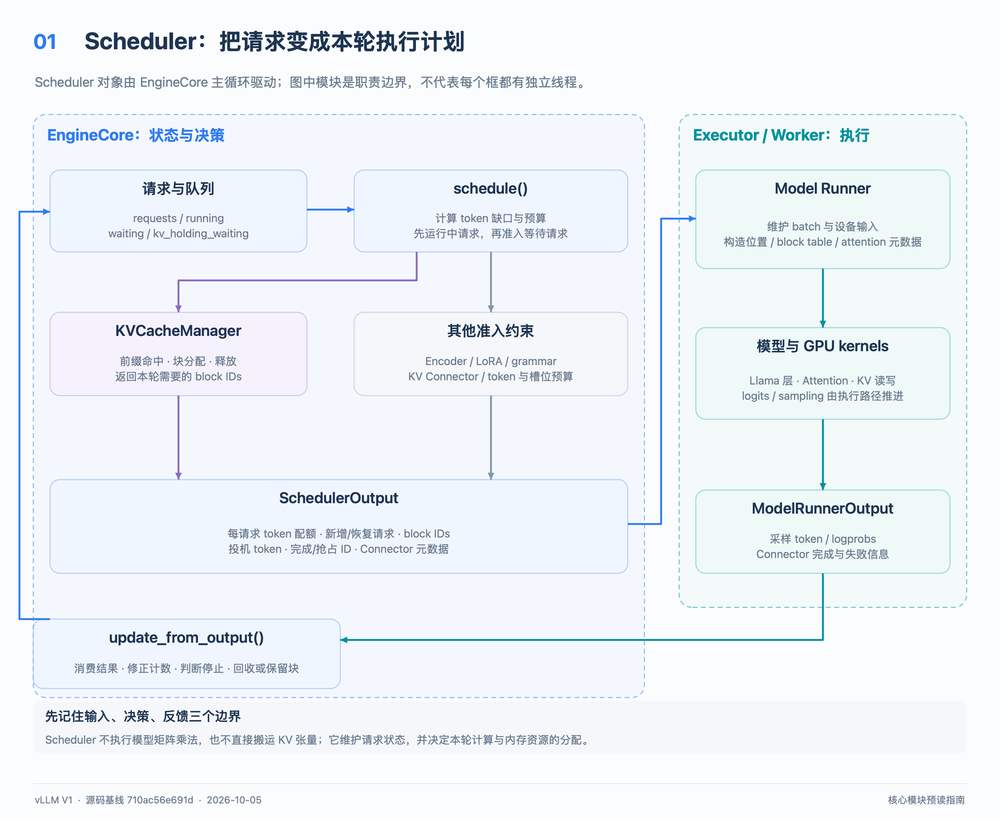
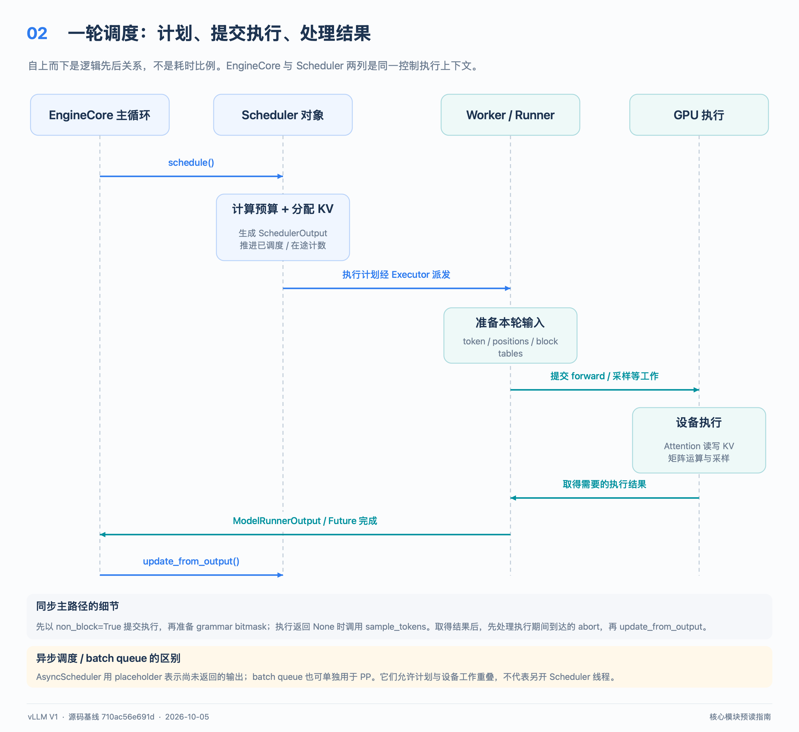
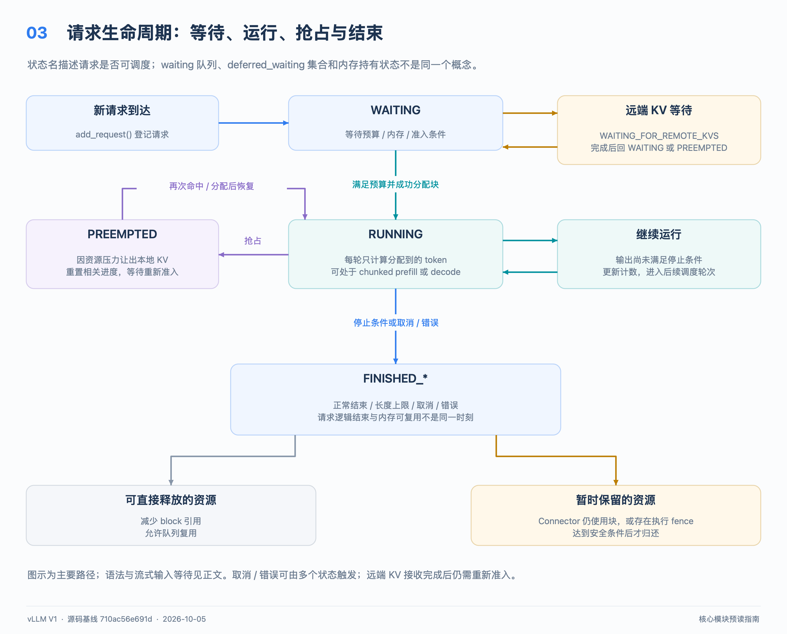

# vLLM V1 Scheduler：从一次调度看懂请求如何前进

本文适合第一次阅读 vLLM 源码的读者。先理解“每轮给哪些请求计算多少个 token”，再进入缓存、异步和抢占分支。
源码基准为本仓库提交 `710ac56e691d4713feca50a43e6c440f07d373fd`，提交日期 **2026-10-05**。
下文描述这份源码的 V1 实现；属于源码预读与教学示例，不是运行测量、性能基准或部署参数建议。
配套阅读：[KV block 管理](kv_block_manager_guide_zh.md)、[Llama 模型执行](llama_model_guide_zh.md)。

配图下载：[全部 9 张高清 PNG](../assets/design/core_modules_guide_zh/core_modules_png.zip)，本文对应图 01～03。

## 1. 先建立一个能用的理解

Scheduler 管理请求的进度和资源许可，把一批请求转成一份“本轮执行清单”。
清单中的核心条目是：**请求 A 计算 4 个位置，请求 B 计算 1 个位置，以及这些位置使用哪些 KV blocks。**
执行清单交给模型执行侧；结果回来后，Scheduler 更新 token、停止状态和缓存生命周期，然后制定下一轮清单。

可以把它理解成三本相互关联的账：

1. **请求账**：谁在等、谁已准入、谁已结束，各自还缺多少计算。
2. **预算账**：本轮允许多少 token、多少请求、多少编码器工作。
3. **缓存账的入口**：向 `KVCacheManager` 申请位置、查询命中、释放请求所占的块。

Scheduler 不负责执行 Llama 的矩阵乘法，也不直接持有 GPU 上的 K/V 张量。
它持有的是调度状态和缓存管理对象；真正的模型 forward、attention 和采样由执行侧完成。
因此，阅读 Scheduler 时最有价值的问题是：“**这个字段在何时增加、何时回退，谁允许这个请求进入下一轮？**”



图中箭头表示调用或数据流，不表示每个框都独占一个进程。
Executor 选型、张量并行和流水线并行配置会改变 worker 的部署方式。

## 2. 最少需要知道的词

| 词 | 本文中的意思 |
| --- | --- |
| token | 模型处理的离散编号；一个汉字、英文单词与 token 并不总是一一对应。 |
| prefill | 为已有输入序列计算模型状态，通常一次处理多个位置。 |
| decode | 利用已有 KV，继续计算并生成后续 token；普通自回归解码通常每请求每轮增加一个输出。 |
| chunked prefill | 长输入分多轮计算，避免一次占满整轮 token 预算。 |
| KV cache / block | attention 保存的 Key/Value 状态，以及管理这些状态的固定容量块。 |
| prefix cache hit | 当前请求的前缀已有可复用状态，因此部分位置不用从头计算。 |
| speculative decoding | 先提出多个草稿 token，再由目标模型验证；被拒绝的位置需要回退记账。 |
| in-flight | 工作已提交，但 Scheduler 尚未处理对应结果。 |
| preemption | 暂停一个已准入请求，释放或安排释放其资源，之后重新调度。 |
| PP | Pipeline Parallelism，模型不同层分布在多个阶段，通过批次流水线执行。 |

源码的 `RequestStatus` **没有 PREFILL 和 DECODE 两种状态**。
二者共享“已计算进度追赶已知 token”的主逻辑；实现仍会用 `is_prefill_chunk` 等字段处理阶段相关限制。
出处：[调度算法说明](../../vllm/v1/core/sched/scheduler.py#L571)、[状态枚举](../../vllm/v1/request.py#L370)。

## 3. 谁创建 Scheduler，谁调用它

[`EngineCore.__init__`](../../vllm/v1/engine/core.py#L114) 先初始化模型执行器和 KV cache 配置，再创建 Scheduler。
Scheduler 的具体类来自 [`SchedulerConfig.get_scheduler_cls`](../../vllm/config/scheduler.py#L229)；普通实现与 `AsyncScheduler` 共用大量逻辑。
一个 EngineCore 拥有自己的 Scheduler；数据并行场景不能理解成所有副本共享同一份 `running` 列表。

在常见的后台进程路径中，[`EngineCoreProc`](../../vllm/v1/engine/core.py#L1088) 包装 EngineCore：

- 输入线程接收 socket 消息、做输入侧处理并写入队列；输出线程把输出队列内容发给客户端。
- 核心循环读取输入队列，调用添加、取消请求等入口，然后调用 `step_fn()`。
- `step_fn` 由是否启用 batch queue 决定，分别指向 `step()` 或 `step_with_batch_queue()`。
- Scheduler 的主调度和结果更新由核心循环串行驱动，不是在每个网络请求的协程里各跑一份。

对应入口：[I/O 线程](../../vllm/v1/engine/core.py#L1168)、[核心循环](../../vllm/v1/engine/core.py#L1473)、[执行一步并投递输出](../../vllm/v1/engine/core.py#L1529)。
非进程客户端和分布式运行方式还会有其他包装；不要把这张调用图当成所有配置的固定进程拓扑。

## 4. 首先认出这些对象和字段

| 对象 / 字段 | 应该怎样读 |
| --- | --- |
| `requests: dict[str, Request]` | 以请求 ID 查询 Scheduler 所保留的请求；某些已结束请求也会因传输未完成暂留。 |
| `running: list[Request]` | 已准入的请求；列表中的请求不一定在本轮获得 token。 |
| `waiting` | 等待准入或重新准入的队列，具体顺序由 FCFS / priority 策略决定。 |
| `kv_holding_waiting` | 已持有 KV 的等待请求；扫描时优先于普通 `waiting`，避免资源持有者被阻塞。 |
| `deferred_waiting` | 记录阻塞或本轮跳过的等待请求的集合；不是第三个独立执行队列。 |
| `finished_req_ids` | 本轮需要通知 worker 清理状态的已完成请求 ID；构建输出后更换集合。 |
| `kv_cache_manager` | 调度侧缓存分配与复用入口，细节见配套 block 管理文档。 |
| `encoder_cache_manager` | 管理图片等编码器输出缓存；纯文本 Llama 预读可先跳过。 |

这些容器的初始化见 [`Scheduler.__init__`](../../vllm/v1/core/sched/scheduler.py#L210)。
FCFS 表示先到先服务；priority 按优先级排序，数值较小者优先，之后再比较到达时间等字段。
这不是“严格禁止任何后面的请求先运行”：运行中请求暂时不能调度时，代码可能继续尝试后面的请求。

对每个 [`Request`](../../vllm/v1/request.py#L60)，最重要的是以下计数：

| 字段 | 含义与注意事项 |
| --- | --- |
| `num_prompt_tokens` | 输入长度；普通请求中固定，流式输入续接会更新。 |
| `num_tokens` | 已知正式 token 总数，即 prompt 加已接收输出，不含草稿与输出占位。 |
| `num_tokens_with_spec` | `num_tokens + len(spec_token_ids)`。 |
| `num_computed_tokens` | 已推进的计算进度；调度后立即增加，可能包含尚未返回的工作。 |
| `num_output_placeholders` | 异步调度预留的待返回输出数量；不能当成已经拿到的 token ID。 |
| `num_in_flight_tokens` | 已调度、尚未处理结果的输入位置数，与“等待几个输出 token”不是同一量。 |
| `num_stale_output_tokens` | 抢占前已提交、之后仍可能返回的工作量；防止旧结果破坏重置后的计数。 |
| `is_prefill_chunk` | 本轮后是否仍有已知序列未覆盖；不是永久的请求分类。 |

字段定义见 [Request 的异步计数](../../vllm/v1/request.py#L163)，派生属性见 [`num_tokens`](../../vllm/v1/request.py#L295)。

## 5. token 账：用具体数字追一遍

对运行中请求，先忽略各种上限，候选计算量为：

```text
本轮候选 token 数
  = num_tokens_with_spec + num_output_placeholders - num_computed_tokens
```

这个减法算的是**要送入模型计算的位置数**，不是本轮一定向用户返回多少 token。
随后还要受 token 预算、输入预算、模型长度、长 prefill 阈值、编码器预算和 KV 空间等限制。
等待请求刚准入时通常使用 `num_tokens - 已命中的计算进度`，还会处理前缀命中、外部 KV 和恢复状态。
出处：[运行请求计算量](../../vllm/v1/core/sched/scheduler.py#L683)、[等待请求计算量](../../vllm/v1/core/sched/scheduler.py#L1096)。

### 例一：6 个输入 token，分两轮 prefill

假设：普通自回归模型、同步调度、没有前缀命中与草稿，允许 chunked prefill，每轮预算为 4，最大输出为 2。
模型长度上限足够大，KV 空间足够，生成的 token 不触发 EOS 或其他停止条件。
设输入为 `p0…p5`，生成结果依次为 `g0`、`g1`。

| 轮次 | 调度前正式总数 T | 调度前进度 C | 分配 `min(T-C, 4)` | 调度后 C | 处理结果后 |
| --- | --- | --- | --- | --- | --- |
| 1 | 6 | 0 | 4 | 4 | 仍是中间 prefill，输出为空，T=6。 |
| 2 | 6 | 4 | 2 | 6 | 消耗到 `p5`，采样得到 `g0`，T=7。 |
| 3 | 7 | 6 | 1 | 7 | 计算 `g0` 的位置，采样得到 `g1`，T=8，达到最大输出数后结束。 |

关键是第 2 轮结束时：已经知道 `g0` 的 ID，但 `g0` 自己的位置尚未计算 KV，所以 `T-C=1`。
这就是下一轮普通 decode 经常只需要一个位置的原因。
中间 prefill 只推进输入，不向 EngineCore 返回部分生成输出。

### 例二：同一轮混合两个请求

假设 `running` 的扫描顺序是 B、A，B 有 `T=9, C=8`，A 有 `T=10, C=6`，总预算为 4。
B 先获得 1 个位置，A 再获得剩余 3 个位置，清单为 `{"B": 1, "A": 3}`。
本轮既有 decode 又有 prefill；批次不是先固定成“prefill 批”或“decode 批”。
若扫描顺序改为 A、B 且没有其他限制，A 可能先耗尽 4 个位置；不要推导出“decode 永远优先”的规则。

### 例三：草稿拒绝为什么要减回去

设正式总数 `T=10`，进度 `C=9`，有 3 个草稿，无输出占位，则候选量为 `10+3-9=4`。
调度后 `C=13`。假设验证返回 2 个正式输出，普通自回归路径按“1 个采样 token + 1 个接受草稿”计算。
因此拒绝 2 个草稿，结果更新把 `C` 减为 11；正式总数增加到 `T=12`，下一轮缺口又是 1。
这对应 [`update_from_output` 的拒绝回退](../../vllm/v1/core/sched/scheduler.py#L2070)；异步路径还要同步减少相关占位数。

## 6. `schedule()`：从队列到执行清单

第一次阅读长函数时，沿以下七步走，不必展开每个模型特化分支。

1. **建立本轮预算与结果容器。** `token_budget` 来自 `max_num_scheduled_tokens`，默认回退到 `max_num_batched_tokens`；`input_budget` 单独计入草稿所需额外槽位。
2. **先扫描 `running`。** 计算每个请求的缺口，应用上限与阻塞条件；无法分到 token 的请求可能被跳过。
3. **先拿 KV 空间，再记入计划。** 调用 `allocate_slots()`；返回 `None` 表示资源条件不满足，可能进入抢占重试。
4. **再扫描等待队列。** 仅在本轮没有发生抢占且调度未暂停时进入；先看 `kv_holding_waiting`，再看 `waiting`。
5. **准入前确认依赖。** 检查语法、远端 KV、流式输入、LoRA 限制与前缀命中；分配成功后移入 `running`，状态设为 `RUNNING`。
6. **生成 `SchedulerOutput`。** 打包每请求 token 数、块表变化、首次请求数据、完成通知，以及可选 connector 元数据。
7. **调用 `_update_after_schedule()` 再返回。** 提前增加 computed 和 in-flight 计数，使下一轮能够看到已经提交的进度。

函数位置：[开始](../../vllm/v1/core/sched/scheduler.py#L571)、[运行请求的分配与抢占](../../vllm/v1/core/sched/scheduler.py#L749)、[等待队列](../../vllm/v1/core/sched/scheduler.py#L882)、[构造输出](../../vllm/v1/core/sched/scheduler.py#L1372)、[推进计数](../../vllm/v1/core/sched/scheduler.py#L1587)。

这里存在两个容易漏掉的顺序约束：

- `SchedulerOutput` 中的计算起点来自本轮推进前的状态；否则 worker 会从错误位置读取输入。
- connector 元数据在 `_update_after_schedule()` 前构造；异步输出占位推进不能提前污染 connector 对本轮进度的观察。

`max_num_active_reqs` 控制进入 RUNNING 的准入数量，`max_num_running_reqs` 对应模型执行侧请求槽位上限。
等待下一段流式输入的会话也可能保留 worker 槽位，不能只数 `len(running)` 判断还剩几个槽位。
本版本还有独立的调度 token 上限和输入预算；不能把所有限制简化成一个 `max_num_batched_tokens`。

## 7. `SchedulerOutput` 是双方的交接单

[`output.py`](../../vllm/v1/core/sched/output.py#L232) 把调度侧对象转换成执行侧需要的数据。
初读时只需要抓住以下字段：

| 字段 | worker 用来做什么 |
| --- | --- |
| `scheduled_new_reqs` | 建立请求本地状态，获得 prompt、参数、块 ID 和起始计算进度。 |
| `scheduled_cached_reqs` | 更新执行侧已有请求，传输增量数据，减少重复通信。 |
| `num_scheduled_tokens` | 确定每个请求本轮处理的位置数。 |
| `scheduled_spec_decode_tokens` | 标明本轮验证的草稿位置。 |
| `scheduled_encoder_inputs` | 指定本轮需计算哪些多模态编码器输入。 |
| `finished_req_ids` / `preempted_req_ids` | 通知执行侧清理或撤下对应请求状态，后者主要用于 V2 model runner。 |
| `kv_connector_metadata` | 传递远端 KV 加载、保存等计划；由对应 worker connector 执行。 |

`CachedRequestData` 的 cached 表示“worker 已保存请求元数据”，不等于“发生了 prefix cache 命中”。
恢复请求也有版本差异：V1 model runner 经 cached 数据表达恢复；V2 model runner 将恢复请求并入 new 数据。
出处：[恢复请求打包](../../vllm/v1/core/sched/scheduler.py#L1373)、[`CachedRequestData`](../../vllm/v1/core/sched/output.py#L138)。

## 8. 主循环与 `update_from_output()`：结果回来后做什么



普通 [`EngineCore.step()`](../../vllm/v1/engine/core.py#L630) 的实际顺序是：

```text
schedule()
  → execute_model(..., non_block=True)
  → get_grammar_bitmask()
  → 等待执行结果；必要时调用 sample_tokens()
  → 处理执行期间收到的 abort
  → update_from_output()
  → EngineCore 输出队列；post_step()
```

`non_block=True` 并不自动意味着启用了 `AsyncScheduler`；这个普通路径也先提交 future，再等结果。
语法 bitmask 用于限制结构化输出的合法采样 token；普通文本请求可先略过。

[`update_from_output()`](../../vllm/v1/core/sched/scheduler.py#L1978) 主要完成以下结算：

1. 推进已完成步骤的释放边界，处理外部 KV 加载失败等情况。
2. 对本轮每个请求减少 in-flight 计数，识别已经结束、被取消或来自抢占前的旧结果。
3. 按实际接受的草稿数量回退多算的进度，再将正式输出追加到 Request。
4. 每追加一个 token 就检查停止条件；达到终止条件时截断多余输出并处理请求结束。
5. 从运行或等待容器移除已停止请求，整理 connector 完成事件与统计，按 `client_index` 返回 `EngineCoreOutputs`。

GPU 返回的结构是 `ModelRunnerOutput`；返回客户端方向的是 `EngineCoreOutputs`，二者用途不同。
Scheduler 更新 token ID 和结束原因；最终文本解码与面向用户的输出整理另有输出处理层。
停止检查可读 [`check_stop`](../../vllm/v1/core/sched/utils.py#L98)，包括 EOS、停止 token、长度和可选重复检测。

## 9. 抢占、结束、等待：状态不要混淆



普通主线是 `WAITING → RUNNING → FINISHED_*`，但 `RUNNING` 只表示已经准入，不保证本轮实际运行。
`RUNNING → PREEMPTED → RUNNING` 表示请求还活着，之后需要重新取得资源。
prefill 和 decode 都可能发生在 RUNNING 内部，不应画成两个 `RequestStatus` 节点。

[`_preempt_request()`](../../vllm/v1/core/sched/scheduler.py#L1542) 释放或延迟释放请求块、清理编码器缓存，并把 `num_computed_tokens` 重置为 0。
它保留正式 prompt 和已生成 token，因此恢复时可以重算所需上下文；若命中缓存，也可能复用一部分进度。
FCFS 路径通常选择 `running` 尾部作为受害者；priority 路径按较大优先级数值、较晚到达时间选择。
抢占前尚未返回的结果会被标为 stale，普通情况下仍可交付输出，但不能再次修改已重置的计数。
某些 reset 或要求 KV 交付的 connector 路径会丢弃 stale 输出；可交付的旧输出未排空时，等待扫描会暂缓恢复。

其他等待状态表示还缺少前置条件：

- `WAITING_FOR_STRUCTURED_OUTPUT_GRAMMAR`：语法编译完成后转 WAITING；编译失败走错误结束。
- `WAITING_FOR_REMOTE_KVS`：等待远端 KV 到达；完成后先恢复 WAITING 或 PREEMPTED，再尝试准入。
- `WAITING_FOR_STREAMING_REQ`：本段输出结束，但会话等待下一段输入；新输入到来后回到 WAITING。

状态处理入口见 [`_handle_blocked_waiting_request`](../../vllm/v1/core/sched/scheduler.py#L3117)。
流式会话本段停止时也可能已有下一段输入排队，此时直接更新为 WAITING，不必先停留在等待输入状态。
续接并非简单追加文本：它保留已计算的输出位置，舍弃上一段末尾尚未计算的采样 token，再合并新输入。

正常停止经 `_handle_stopped_request()` 和 `_free_request()`；外部取消经 [`finish_requests()`](../../vllm/v1/core/sched/scheduler.py#L2601)。
**逻辑结束、通知 worker、物理块可复用是三个时点。** 远端传输未完成或旧 GPU 工作仍可能写入时，释放可能延后。
异步 consumer connector 与多批次重叠时，代码通过步骤序号保护延迟释放；不是“所有异步请求一律立即 free”。
详见 [`_free_request_blocks`](../../vllm/v1/core/sched/scheduler.py#L2718) 与配套 [block 生命周期](kv_block_manager_guide_zh.md)。

## 10. 异步调度与异步 I/O 是两回事

异步 I/O 指 socket、队列或 API 协程的并发收发；异步调度指上一轮结果尚未回到 Scheduler 时，仍可继续安排后续工作。
[`AsyncScheduler`](../../vllm/v1/core/sched/async_scheduler.py#L14) 没有重写整个 `schedule()`，主要扩展调度后记账和结果更新。
非中间 prefill 的步骤会预留输出占位，实际草稿 ID 等信息可在 worker 侧补齐。

例如 prompt 最后一轮已安排完，正式长度仍是 6、计算进度已是 6，但预期有 1 个输出占位。
下一轮候选量为 `6+1-6=1`：Scheduler 可以预先安排下一位置，不需要先拿到这个输出的 CPU token ID。
结果返回后再追加真实 token、扣除占位；草稿拒绝和抢占也必须一起修正这些计数。
PP 的 V2 model runner 还通过 `next_decode_eligible_step` 限制同一请求的 decode 调度节奏。

[`step_with_batch_queue()`](../../vllm/v1/engine/core.py#L670) 优先提交新批次，队列未满且仍有工作时可直接返回，稍后再消费最老的结果。
batch queue 也用于 PP；不能看到队列就断言所有逻辑都来自 AsyncScheduler。
结构化输出可能需要前一步真实 token 才能推进语法状态，此时采样要延后到前一步结果处理之后。
所以“异步”表示减少等待依赖，不表示不需要顺序约束，也不表示 GPU 同时任意执行所有请求。

## 11. connector 只先看这条闭环

Scheduler 侧 connector 负责匹配外部 KV、观察分配结果并构造元数据；worker 侧 connector 负责实际传输。
闭环是：`查询外部命中 → 分配块 → 构造传输计划 → worker 执行 → 返回完成/失败信息 → 更新等待状态或释放块`。
异步加载可以先占有块、进入 `WAITING_FOR_REMOTE_KVS`，而本轮没有该请求的 forward token。
因此 `total_num_scheduled_tokens == 0` 不必然意味着系统没有工作，仍可能需要推进 connector 与清理通知。
接收完成只先记录事件；后续等待扫描才推进该请求的状态，详见 [`_update_from_kv_xfer_finished`](../../vllm/v1/core/sched/scheduler.py#L3151)。

## 12. 15 分钟源码预读路线

| 时间 | 打开哪里 | 看完应能回答 |
| --- | --- | --- |
| 0–2 分钟 | [Request 计数与状态](../../vllm/v1/request.py#L163) | T、C、占位、in-flight 分别是什么？ |
| 2–4 分钟 | [EngineCore.step](../../vllm/v1/engine/core.py#L630) | 谁调用 schedule，何时处理取消和 GPU 结果？ |
| 4–8 分钟 | [Scheduler.schedule](../../vllm/v1/core/sched/scheduler.py#L571) | 先扫描谁，哪些预算能阻止请求，哪里申请 KV？ |
| 8–10 分钟 | [SchedulerOutput](../../vllm/v1/core/sched/output.py#L232) 与 [推进计数](../../vllm/v1/core/sched/scheduler.py#L1587) | worker 看到哪个计算起点？ |
| 10–12 分钟 | [update_from_output](../../vllm/v1/core/sched/scheduler.py#L1978) | 草稿拒绝、停止和迟到结果如何结算？ |
| 12–14 分钟 | [AsyncScheduler](../../vllm/v1/core/sched/async_scheduler.py#L14) 与 [batch queue](../../vllm/v1/engine/core.py#L670) | 上一步未返回，下一步凭什么还能安排？ |
| 14–15 分钟 | [_preempt_request](../../vllm/v1/core/sched/scheduler.py#L1542) | 重置了什么，保留了什么，恢复要等什么？ |

首次阅读可暂时折叠 Mamba 对齐、SWA replay、EC connector、DP prefill 节奏、LoRA 与 diffusion 分支。
这些分支都在基础进度与资源约束上增加条件；理解纯文本路径之后，再按模型或运行配置展开。

## 13. 用已有测试对照理解

以下是**源码阅读入口，本次文档工作没有执行这些测试**。它们可帮助观察最小输入和预期状态变化。

- [test_scheduler.py](../../tests/v1/core/test_scheduler.py)：先找 `test_schedule`、`test_schedule_partial_requests`、`test_stop_via_update_from_output`，对照普通准入、分块与停止。
- [test_async_scheduler.py](../../tests/v1/core/test_async_scheduler.py)：找 `test_stop_by_max_tokens`、`test_kv_pressure_preemption_with_inflight_output`，理解占位与迟到结果。
- 同文件的 `test_connector_metadata_precedes_async_placeholder_advance` 验证 connector 元数据构造与占位推进的先后关系。
- [test_deferred_block_free.py](../../tests/v1/core/test_deferred_block_free.py)：找 `test_finish_defers_free_until_inflight_step_done`，理解请求结束为何不等于块立即可复用。
- [test_scheduler_streaming.py](../../tests/v1/streaming_input/test_scheduler_streaming.py)：找 `test_streaming_e2e_lifecycle`，理解一段结束与整个会话结束的差别。

预读完成后，用第 5 节的数字例子手算每轮 `num_scheduled_tokens`，再在源码里定位对应增减位置。
若能同时解释“为什么 T 比 C 多 1”“为什么 RUNNING 未必执行”“为什么 FINISHED 未必立即释放块”，就可以继续读缓存管理和模型执行部分。
