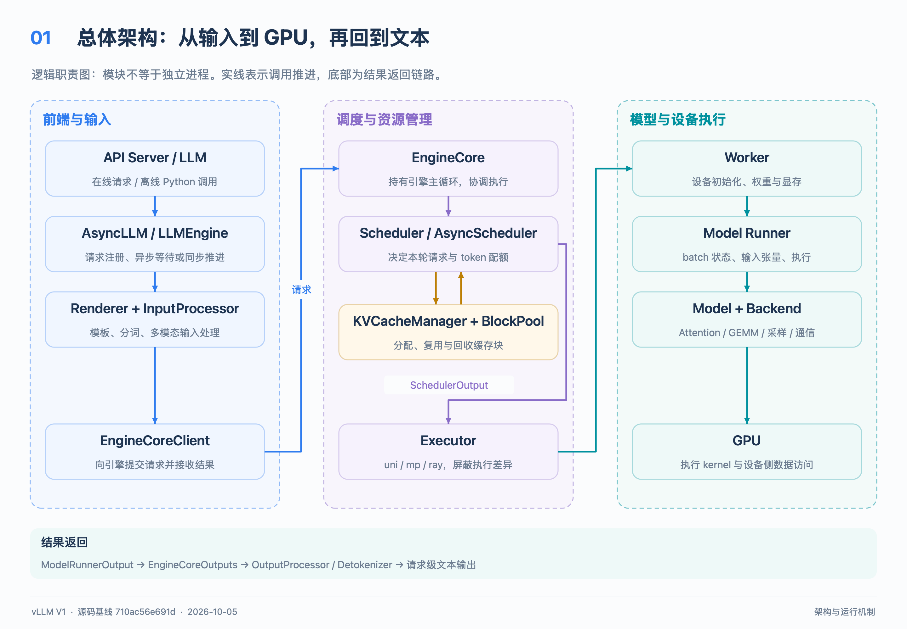
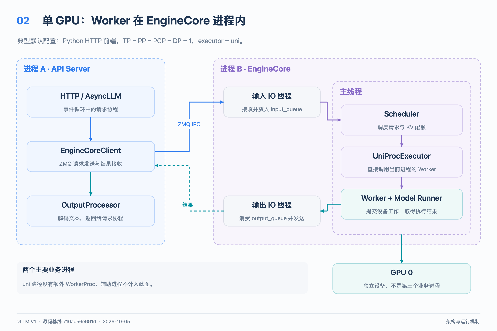
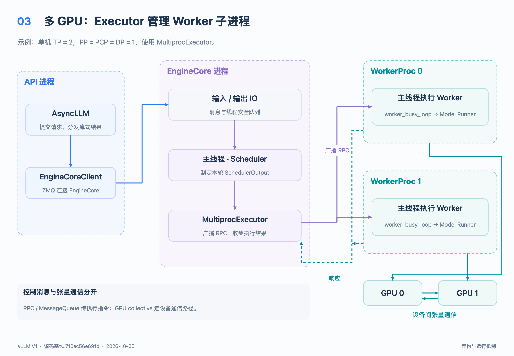
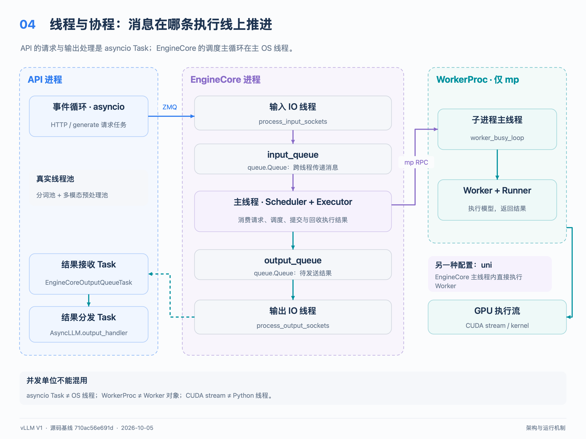
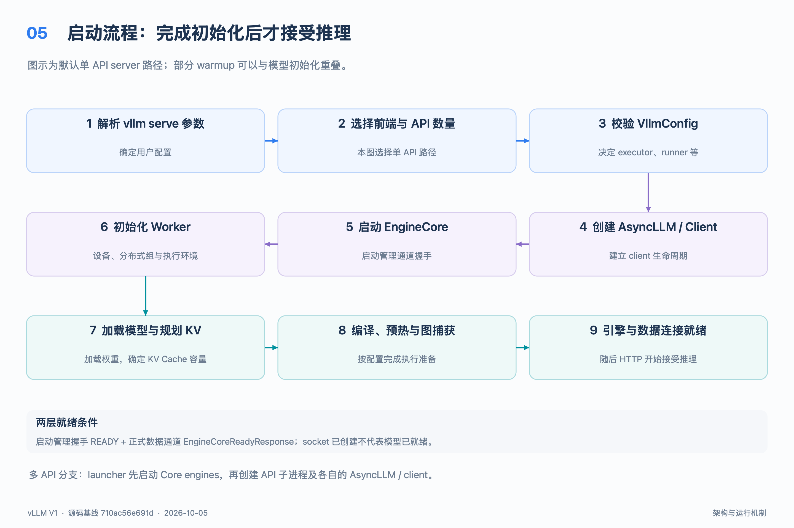
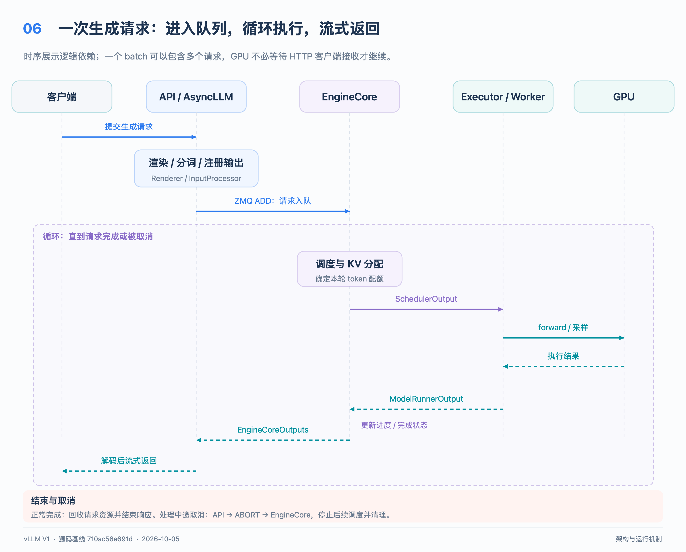
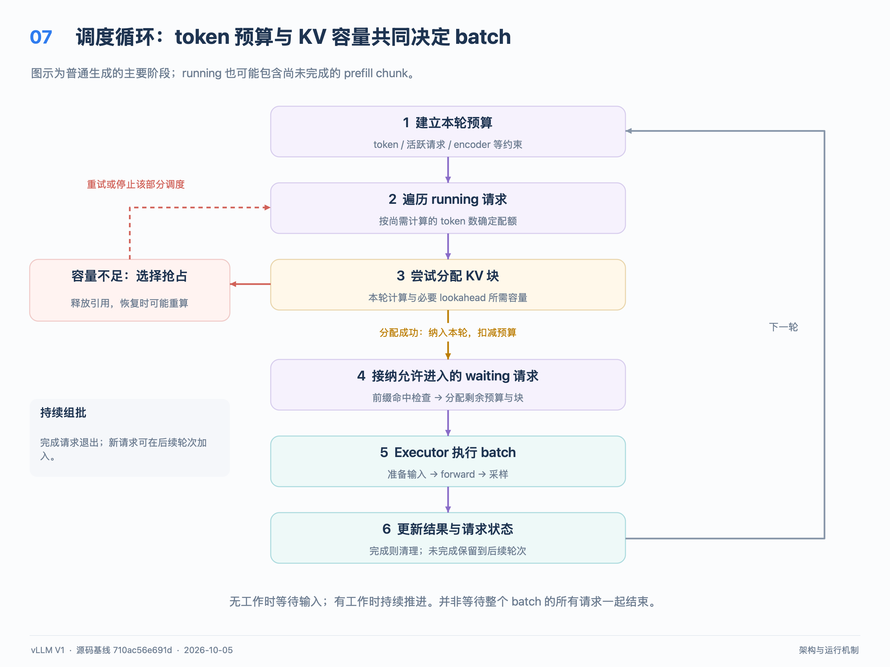
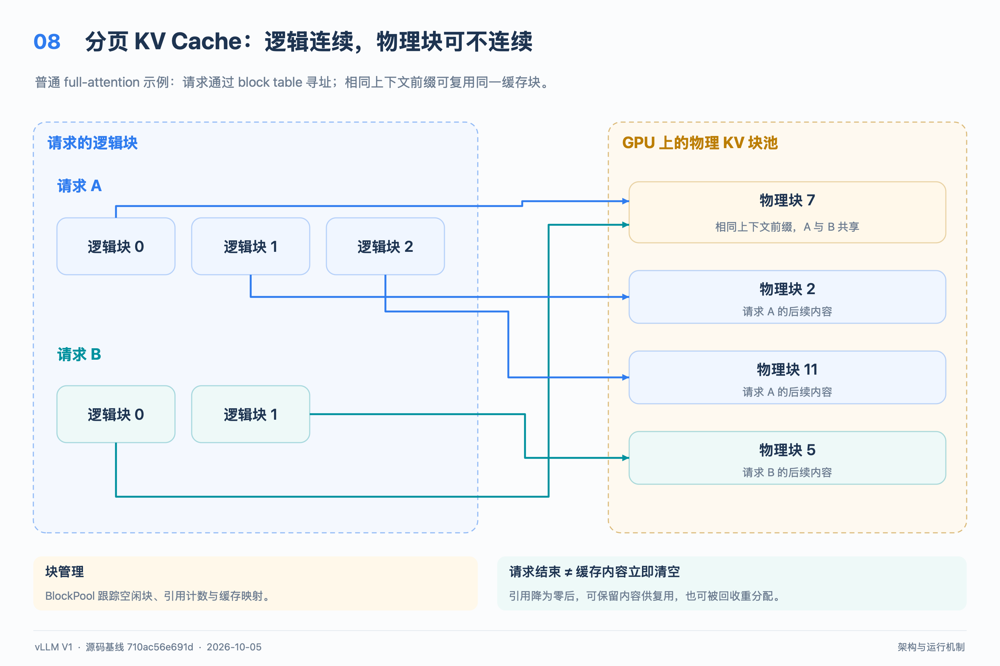
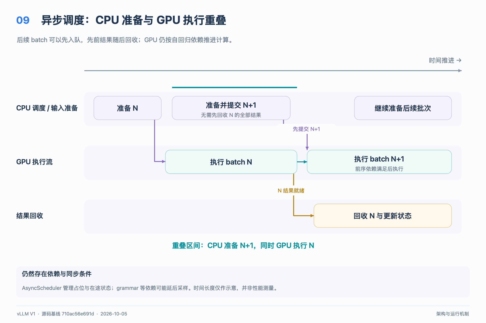

# vLLM 架构设计与运行机制

> 版本基线：本仓库提交 `710ac56e691d4713feca50a43e6c440f07d373fd`，提交日期 2026-10-05。以 V1 引擎、Python HTTP 服务、GPU 文本生成路径为主；离线推理、分布式执行、多模态和混合模型在相应章节说明差异。本文中的 Model Runner V2 是执行器内部的演进，不代表存在一套名为 V2 的服务引擎。

vLLM 是面向大模型的推理与服务系统。它把请求处理、计算调度、KV Cache 管理、模型执行和设备通信分层，持续把不同请求当前需要计算的 token 组合成批次。理解它的关键，是同时看清三件事：**谁持有请求状态、谁决定本轮计算什么、谁在 GPU 上完成计算**。

运行时采用进程、线程、协程和 GPU 执行流共同协作的结构。典型在线服务将 API 与 EngineCore 分进程；多 GPU 时再由 executor 管理 Worker。单 GPU 默认使用 `UniProcExecutor`，Worker 与 EngineCore 同进程，因此不能把逻辑模块直接等同于独立进程。

阅读顺序：先看第 1—4 节建立整体模型，再看第 5—8 节理解请求与调度，最后按第 12 节的源码路线深入。9 张流程图以宽 2880 像素的高清 PNG 直接嵌入；每张图后保留逻辑关系的 Mermaid 源码链接。

[下载全部 PNG 图片](../assets/design/vllm_architecture_zh/vllm_architecture_png.zip)

## 1 推理任务为什么需要专门的系统设计

### 1.1 Prefill 与 Decode 的工作不同

Prefill 处理输入上下文，建立各层的 Key 和 Value 缓存，并在提示词末尾得到用于生成首个输出 token 的结果。Decode 则反复使用已有 KV Cache，继续生成后续 token。普通自回归生成中，一个请求通常每轮推进一个新 token；投机解码等机制会改变这个数量。

长提示词的 prefill 往往包含较大的矩阵运算；小批量 decode 常受权重和 KV 数据访问带宽、CPU 发射开销影响。实际瓶颈取决于模型、序列长度、批量和硬件，不能把两者简单固定为“只受算力限制”或“只受带宽限制”。

### 1.2 主要矛盾与设计选择

| 系统问题 | vLLM 的主要机制 | 需要承担的代价 |
| --- | --- | --- |
| 请求随时到达，长度和完成时间不同 | Continuous Batching，每轮重新组合活跃请求 | 每轮都要维护调度与请求状态 |
| 长上下文的 KV 占用大，连续预留容易浪费 | 分块分配 KV，逻辑 block table 映射物理块 | 需要块管理、间接寻址和兼容的 attention backend |
| 长 prefill 容易拉长其他请求的等待 | token 预算和 Chunked Prefill | 预算过小会增加长提示词完成 prefill 的轮数 |
| 相同前缀重复计算 | Automatic Prefix Caching，简称 APC | 命中取决于请求分布、块大小和缓存存留 |
| GPU 等待 CPU 准备下一批输入 | 增量 batch 状态、异步调度、编译与 CUDA Graph | 状态依赖、缓冲区生命周期和同步更复杂 |
| 单 GPU 容量或吞吐不足 | TP、PP、DP 等并行机制 | 通信、同步、负载均衡和部署复杂度增加 |

这些设计共同追求更高的有效 GPU 利用率，并在吞吐、首 token 延迟和后续 token 延迟之间做取舍。单独增加线程数，通常无法解决这些资源分配问题。

## 2 总体架构与职责边界

### 2.1 逻辑架构图

下图表示调用和数据关系，框不代表进程。



[逻辑关系的 Mermaid 源码](../assets/design/vllm_architecture_zh/01_architecture.mmd)

### 2.2 各层负责什么

**服务与输入层**处理 HTTP、模板渲染、分词和多模态输入预处理，把用户输入转为引擎可以消费的请求。API Server 负责协议适配；`AsyncLLM` 负责请求注册、异步提交和结果分发。它们不拥有 GPU 的逐轮调度决策。

**EngineCore**拥有推理主循环，协调 Scheduler、KV Cache Manager 和 Executor。Scheduler 决定本轮各请求计算多少 token、分配哪些 KV 块、哪些请求等待或被抢占；KV Cache Manager 管理块的逻辑分配和引用关系。

**Executor**负责把调用送到一组 Worker，并收集结果。`UniProcExecutor` 直接调用本进程对象；`MultiprocExecutor` 管理 Worker 子进程及消息队列；Ray executor 使用 Ray 的执行和资源管理机制。Scheduler 不需要直接处理这些进程差异。

**Worker**负责设备初始化、分布式环境、权重加载、显存与执行生命周期。**Model Runner**负责把调度结果转为输入张量和 attention metadata，维护 batch 状态，执行 forward 和采样等操作。底层模型、算子、编译器与通信 backend 完成实际计算。

**输出层**把 token ID 转为文本，维护每个请求的输出状态并分发结果。EngineCore 可判断 token 级终止条件；前端还要处理 stop string 等文本级终止条件，必要时反向取消引擎内请求。

源码：[AsyncLLM](../../vllm/v1/engine/async_llm.py)、[EngineCore](../../vllm/v1/engine/core.py)、[Executor 接口](../../vllm/v1/executor/abstract.py)、[OutputProcessor](../../vllm/v1/engine/output_processor.py)。

### 2.3 状态归属与核心数据对象

| 对象 | 所属边界 | 含义 |
| --- | --- | --- |
| `EngineCoreRequest` | 前端 → EngineCore | 输入 token、生成参数及附加输入信息 |
| `Request` | EngineCore | 调度器维护的请求状态、已计算 token 数和生命周期 |
| `SchedulerOutput` | Scheduler → Executor → Worker | 本轮 token 配额、新请求、缓存请求增量与块信息 |
| `ModelRunnerOutput` | Worker → EngineCore | 模型执行／采样后的结果 |
| `EngineCoreOutputs` | EngineCore → 前端 | 按客户端分发的一组请求输出及统计 |
| `RequestOutput` | 前端 → 调用者 | 用户可见的文本、token 和完成信息 |

前端、调度器和 Worker 各有适合自身任务的状态。Worker 持久化 batch 数据以避免每轮重建大张量，Scheduler 保留调度所需状态；两者通过调度增量与执行结果保持一致。跨进程对象通常是编码后传输的消息，不能当成多个进程共享的普通 Python 对象。

源码：[引擎消息](../../vllm/v1/engine/__init__.py)、[调度输出](../../vllm/v1/core/sched/output.py)、[请求状态](../../vllm/v1/request.py)、[模型执行输出](../../vllm/v1/outputs.py)。

## 3 进程模型

### 3.1 默认单 GPU 在线服务

条件：Python HTTP 前端，TP、PP、PCP、DP 均为 1，未显式覆盖 executor。



[逻辑关系的 Mermaid 源码](../assets/design/vllm_architecture_zh/02_single_gpu_processes.mmd)

这里有两个主要业务进程。Worker 是 EngineCore 进程中的对象，没有额外的 `WorkerProc`。实际进程列表还可能包含 Python resource tracker、forkserver 或运行库辅助进程，所以“两个”不是对 `ps` 输出总行数的承诺。

### 3.2 多 GPU 的 mp executor

例如单机 TP=2、PP=PCP=DP=1，使用 `MultiprocExecutor`：



[逻辑关系的 Mermaid 源码](../assets/design/vllm_architecture_zh/03_multi_gpu_processes.mmd)

控制面消息负责广播执行指令与调度数据；GPU 之间的 collective 或激活张量传输属于另一条数据路径。不能把 TP 的 all-reduce 理解成经 API Server 转发。

### 3.3 并行规模与进程数量

对常见非 external launcher 路径，一个 DP rank 内的模型执行 world size 为 `TP × PP × PCP`；PCP 是 prefill context parallelism。PCP=1 时退化为常见的 `TP × PP`。每个 DP rank 有自己的 EngineCore 和执行资源。

| 配置示例 | 主要业务进程 |
| --- | --- |
| 单 GPU，默认 uni | 1 API + 1 EngineCore，Worker 内嵌 |
| 单机 TP=4，DP=1，mp | 1 API + 1 EngineCore + 4 WorkerProc |
| 单机 TP=2，DP=4，内部负载均衡，mp | 通常 4 API + 4 EngineCore + 8 WorkerProc + 1 DP Coordinator |

表中最后一种配置还可能有独立 launcher 管理进程；多节点、Ray、headless 和 external launcher 也会改变拓扑。应分别统计 API、EngineCore、Worker、协调与管理进程，避免套一个无条件总数公式。

DP Coordinator 是否存在由配置决定。内部／混合负载均衡需要统计协调；MoE 的跨 DP 执行还需要 wave 协调。普通非 MoE 模型采用外部负载均衡时，不必然创建该协调进程。API 数量也可独立配置，并非任何模式下都固定等于 DP。

源码：[executor 选择](../../vllm/config/parallel.py)、[单进程执行](../../vllm/v1/executor/uniproc_executor.py)、[多进程执行](../../vllm/v1/executor/multiproc_executor.py)、[CLI 启动分支](../../vllm/entrypoints/cli/serve.py)、[`needs_dp_coordinator`](../../vllm/config/vllm.py)。

## 4 线程与协程模型

### 4.1 先区分四种并发单位

| 单位 | 在 vLLM 中的典型用途 | 边界 |
| --- | --- | --- |
| OS 进程 | API、EngineCore、mp Worker | 独立地址空间，经 IPC 协作 |
| OS 线程 | socket IO、分词线程池、进程监控 | 同进程共享内存，经线程安全队列等同步 |
| asyncio Task | HTTP 请求、结果接收与分发 | 通常共享一个事件循环线程，在 `await` 处协作调度 |
| CUDA stream 与 GPU kernel | 设备计算、拷贝、部分计算通信重叠 | GPU 执行机制，不是 Python 线程 |

一个请求通常对应异步任务和请求状态，不会因此分配一个独占的推理线程或 GPU。一个 GPU kernel 内的大量 CUDA threads，也不属于本节讨论的 Python／CPU 线程。

### 4.2 API Server 内部

API 主线程运行 uvloop／asyncio 事件循环。接收 HTTP 请求、等待引擎结果、流式发送响应等任务在这里交错执行；等待时把运行机会交给其他任务。

两条关键后台任务是 `EngineCoreOutputQueueTask` 和 `AsyncLLM.output_handler`。前者从 ZMQ 收取结果并放入 `asyncio.Queue`；后者执行输出处理，把结果分发给每个请求的 collector。它们都是 **asyncio Task**。输出处理还会分 chunk 并适时让出事件循环，避免一次处理大量结果长时间占用前端。

阻塞分词由 Renderer 的线程池承接，池大小取自 `renderer_num_workers`。多模态预处理另有单 worker 的线程池，避免与分词互相排队，并维持该路径要求的顺序。媒体读取和底层库还可能有额外线程，不能把这两个池当作全部线程数。

### 4.3 EngineCore 与 Worker 内部



[逻辑关系的 Mermaid 源码](../assets/design/vllm_architecture_zh/04_threads_and_coroutines.mmd)

图中展示 mp 执行路径；若使用 uni，则由 EngineCore 主线程直接调用进程内的 Worker。Executor 始终属于所示 EngineCore 进程。

Scheduler 的主要状态更新位于 EngineCore 主循环。输入线程可以同时接收、解码和预处理新消息，但不会为每个请求新建一个 Scheduler 线程；它把消息交给主循环消费。输出线程则把已完成的结果序列化并发送给对应前端。

`run_busy_loop` 表示持续运行的服务循环。EngineCore 无工作时会等待输入队列，不能据此断言“空闲时永久占满一个 CPU 核”。mp 的共享内存队列可在近期活跃时短暂自旋、闲置后等待通知，这是不同层面的等待策略。

### 4.4 关键线程与任务速查

| 所属进程 | 名称或入口 | 类型与条件 |
| --- | --- | --- |
| API | HTTP handler、`generate`、`output_handler` | asyncio Task |
| API | `EngineCoreOutputQueueTask` | asyncio Task，异步 client 收结果 |
| API | Renderer tokenizer executor | OS 线程池 |
| API | Renderer MM executor | OS 线程池，单 worker，按使用启动工作线程 |
| API | `MPClientEngineMonitor` | OS 守护线程，client 自己管理本地 EngineCore 时 |
| EngineCore | `run_busy_loop` | 主 OS 线程 |
| EngineCore | `process_input_sockets` | OS 守护线程，接收消息并入队 |
| EngineCore | `process_output_sockets` | OS 守护线程，编码结果并发送 |
| EngineCore | `signal-callback` | OS 守护线程，处理信号后的唤醒回调 |
| EngineCore | `MultiprocWorkerMonitor` | OS 守护线程，仅 mp executor |
| WorkerProc | `worker_busy_loop` | Worker 子进程主 OS 线程 |
| WorkerProc | `DeathPipeMonitor` | OS 守护线程，监控父进程死亡 |
| WorkerProc | `WorkerAsyncOutputCopy` | OS 守护线程，仅 mp 且启用 async scheduling |
| 同步 client 所在进程 | `EngineCoreOutputQueueThread` | OS 线程，属于 SyncMPClient 路径 |

输入／输出 IO 线程在源码中通过 target 创建，没有显式赋予上述方法名作为线程名。结构化输出、ZMQ、PyTorch、通信库等还能创建其他线程，因此本表用于解释职责，不是固定线程配额。

源码：[异步 client](../../vllm/v1/engine/core_client.py)、[前端异步任务](../../vllm/v1/engine/async_llm.py)、[Renderer 线程池](../../vllm/renderers/base.py)、[EngineCore 线程](../../vllm/v1/engine/core.py)、[Worker 线程](../../vllm/v1/executor/multiproc_executor.py)、[共享内存队列等待策略](../../vllm/distributed/device_communicators/shm_broadcast.py)。

## 5 启动与就绪流程

下图展示默认单 API server 路径。



[逻辑关系的 Mermaid 源码](../assets/design/vllm_architecture_zh/05_startup.mmd)

这是主要依赖关系图，部分预处理 warmup 可以与模型初始化重叠。多 API 模式由 launcher 先启动 Core engines，再创建 API 子进程及各自的 AsyncLLM／client。配置校验还会决定 attention backend、runner 版本、异步调度等能力组合。

就绪涉及两个层次：启动管理通道上的 `HELLO`／初始化／`READY`，以及正式数据通道的身份注册和 `EngineCoreReadyResponse`。只有地址创建成功，并不表示权重加载、KV 初始化和数据链路全部就绪。

当前 CLI 在用户没有覆盖时倾向使用 `spawn`；库调用的进程创建方式还受环境变量、CUDA 是否已初始化等条件影响。离线脚本中的 `__main__` 保护与这些差异有关，不能把一个固定的 fork／spawn 结论套到全部入口。

源码：[API 实际入口](../../vllm/entrypoints/launchers/api_server/entry.py)、[EngineCore 启动管理](../../vllm/v1/engine/utils.py)、[EngineCore 初始化](../../vllm/v1/engine/core.py)、[CLI 环境设置](../../vllm/entrypoints/serve/utils/api_utils.py)。

## 6 一次在线生成请求的完整流程

### 6.1 请求时序图



[逻辑关系的 Mermaid 源码](../assets/design/vllm_architecture_zh/06_request_flow.mmd)

图中循环表示逻辑依赖，不表示每轮都等待 HTTP 客户端接收后才执行下一轮。一个调度批次也会包含多个用户的请求。尚未完成的 prefill chunk 通常不会产生用户可见输出；输出 chunk 与 tokenizer token 也不是必然一一对应。

断连／取消分支可发生在处理中途。已经提交的 GPU 工作不一定立即被撤回，取消主要通过移除后续调度和清理状态生效；KV 传输等路径还可能延后部分资源释放。

### 6.2 通信路径

| 边界 | 常见传输方式 | 说明 |
| --- | --- | --- |
| 用户 → API | HTTP，流式响应可使用 SSE | 协议与网络连接由服务层处理 |
| API → EngineCore | ZMQ ROUTER → DEALER | 按 engine identity 路由请求，消息由 Msgpack 编解码 |
| EngineCore → API | ZMQ PUSH → PULL | 按 `client_index` 路由结果 |
| EngineCore → uni Worker | 本进程方法调用 | 不经过 WorkerProc RPC 队列 |
| EngineCore → mp Workers | 广播 MessageQueue | 本机小消息可用共享内存 ring buffer |
| mp Workers → EngineCore | 响应 MessageQueue | 根据调用的 output rank／聚合需求收结果 |
| GPU → GPU | 分布式设备通信 | 承担 TP collective、PP 激活等传输 |

API／Core 的本地 ZMQ 链路通常用 IPC 地址，远程 DP 连接需要 TCP。mp 广播队列对本机大消息可通过 ZMQ 传 payload，对远程接收者使用网络传输；“使用共享内存队列”不代表所有消息和跨节点数据都走共享内存。多模态 tensor IPC 又是可选的额外传输路径。

源码：[请求提交与输出分发](../../vllm/v1/engine/async_llm.py)、[ZMQ client](../../vllm/v1/engine/core_client.py)、[Core socket 处理](../../vllm/v1/engine/core.py)、[MessageQueue](../../vllm/distributed/device_communicators/shm_broadcast.py)。

## 7 调度器的设计与循环

### 7.1 以 token 进度统一请求

Scheduler 的核心模型是让请求的 `num_computed_tokens` 追赶其待计算 token 进度，相关状态包含 `num_tokens_with_spec`，异步调度还计入未返回输出的占位。Prefill、decode、chunked prefill 和部分投机解码可由同一套进度模型表达，不必用两套完全分离的队列算法处理。

`num_computed_tokens` 可以在安排计算后乐观推进，不能直接解释为 GPU 已全部计算完成的位置。系统另行跟踪在途工作，并在处理结果、投机 token 被拒绝等情况下校正相关状态。

普通 decode 请求常只需要推进一个 token；长提示词可能还需要推进很多 token。调度器同时受本轮 token 预算、最大活跃请求数、可用 KV 块、encoder 预算以及特定功能约束影响。

`max_num_batched_tokens` 限制单轮输入处理容量，不是请求数，也不是所有活跃请求上下文长度的总和。Scheduler 实际发放配额还受 `max_num_scheduled_tokens` 约束；两者通常相同，但模型执行阶段可能追加 drafting token 时，后者可以更小。

`max_num_seqs` 同时影响 runner 的请求容量等配置；`max_num_active_seqs` 则可进一步收紧进入 RUNNING 的请求数量，而不缩小 runner／图捕获容量。token 预算、请求接纳上限和显存容量分别约束不同资源。

### 7.2 调度流程图



[逻辑关系的 Mermaid 源码](../assets/design/vllm_architecture_zh/07_scheduler.mmd)

图中省略了 running／waiting 内部遍历和多次分配重试，展示的是普通生成路径的决策阶段。实际代码还包含暂停、grammar readiness、多模态输入预算、KV connector 等分支。

当前基础算法先考虑 running，再在条件允许时接纳 waiting。这并不等于“绝对 decode 优先”：已经进入 running 的长 prefill 请求仍可继续占用预算。waiting 的队列策略可按配置使用 FCFS 或 priority，抢占也会参考策略。

### 7.3 Continuous Batching 与 Chunked Prefill 示例

假设本轮 token 预算为 8，开启 chunked prefill，未设置每请求的 long-prefill cap，序列容量和 KV 充足，无前缀命中、投机解码或特殊限制。A、B 已处于 decode，分别需要计算 1 个 token；C 是包含 10 个输入 token 的新请求。下表中的数字是**模型本轮计算的输入 token 数**。

| 调度轮次 | A | B | C | D | 本轮结果 |
| --- | --- | --- | --- | --- | --- |
| 第 1 轮 | decode 1 | decode 1 | prefill 6 | 未到达 | 用满 8；C 尚未完成 prefill |
| 第 2 轮 | decode 1 | decode 1 | prefill 4 | 未到达 | C 完成 prefill，可采样首个输出；假设 B 完成 |
| 第 3 轮 | decode 1 | 已退出 | decode 1 | 新请求 prefill 6 | B 的位置被释放，D 加入，继续用满 8 |

Continuous Batching 体现在 B 完成后退出、D 在后续轮次加入，无需等待 A 和 C 一起结束。Chunked Prefill 体现在 C 的 10 个输入 token 被分为 6 和 4 两次计算。

### 7.4 KV 不足与抢占

在主路径中，当前请求所需 KV 无法分配时，Scheduler 可以选择请求进行抢占，释放其块引用，并把它放回等待状态。后续恢复可能需要重新计算已有上下文；可复用缓存仍可能减少部分重算。

因此，抢占可以让系统继续推进，却会消耗额外计算并拉长延迟。不能把 V1 的常规抢占统一描述为“把 KV swap 到 CPU，再无损地原地恢复”。显式 KV offloading／connector 是另外的功能路径。

源码：[Scheduler](../../vllm/v1/core/sched/scheduler.py)、[调度配置](../../vllm/config/scheduler.py)、[KVCacheManager](../../vllm/v1/core/kv_cache_manager.py)。

## 8 KV Cache 与显存管理

### 8.1 分页思想

对常见 Transformer，自回归生成需要保留各层历史 token 的 K、V。vLLM 将这些缓存按块组织，每个请求通过 block table 找到自己的物理块，物理块不必连续。



[逻辑关系的 Mermaid 源码](../assets/design/vllm_architecture_zh/08_kv_cache.mmd)

图示为普通 full-attention 场景，A、B 复用一个内容和上下文均匹配的完整前缀块。请求继续增长时再追加需要的块，从而减少为最大长度预留大段连续缓存的浪费。分页仍存在尾块未用满等开销，并不意味着显存利用率始终达到 100%。

这里的 KV block 是缓存分配单位，不是 CUDA thread block，也不是操作系统自动管理的虚拟内存页。Attention backend 使用 block table 和相应 metadata 访问正确的缓存位置。

### 8.2 KVCacheManager 与 BlockPool

`KVCacheManager` 负责查询可复用块、计算请求所需容量、分配 slot 和释放请求引用；下层 coordinator／不同类型 manager 处理不同 attention 或混合缓存需求。`BlockPool` 管理块对象、缓存映射、引用计数和空闲队列。

请求结束后，引用计数可降为零；块可以进入可回收集合，同时继续保留内容哈希以供前缀复用。后续实际重分配时才可能淘汰缓存记录。因此“没有活跃请求引用”和“内容已经清空”不是同一件事。

### 8.3 前缀缓存为什么必须包含上下文

同一个 token 出现在不同上下文中，其 KV 通常不同。APC 的块标识需要包含前序块哈希、当前块 token 和必要的附加身份信息；多模态内容与 LoRA 等条件也会影响是否可复用。

常规路径以完整块前缀复用为主。当前提交中，特定混合 Mamba 路径还实现了 partial-block hash／命中与相应复制处理；不能把历史文档中的“仅完整块”当成所有模型的永久限制。APC 复用的是缓存计算结果，不是把整个自然语言回答缓存后直接返回。

即使普通生成请求的整个 prompt 都能命中缓存，仍需为取得下一 token 的 logits 重算末尾位置，块对齐还可能扩大重算范围。因此“前缀全部命中”不等于“无需模型计算即可生成首 token”。

### 8.4 一个便于建立直觉的显存估算

对于所有层形状相同、普通 full attention、未做 KV 分片或量化的简化情况：

```text
KV 字节数 ≈ token 总数 × 层数 × KV heads 数 × head dimension
           × 2（K 与 V）× 每元素字节数
```

例如 32 层、8 个 KV heads、head dimension 为 128、BF16 每元素 2 字节，则每个 token 的 KV 约为 `32 × 8 × 128 × 2 × 2 = 131072` 字节，即 128 KiB；8192 token 约为 1 GiB。这不包括权重、activation、workspace、图捕获和块元数据开销。

这里用的是 KV heads 数，不能直接替换为 query heads 数。TP／PP 下的每卡分配、KV head 复制、量化、滑动窗口、MLA 与 Mamba 状态都会改变计算方式，真实容量应以实际 `KVCacheSpec` 和初始化结果为准。

源码：[KVCacheManager](../../vllm/v1/core/kv_cache_manager.py)、[BlockPool](../../vllm/v1/core/block_pool.py)、[KV coordinator](../../vllm/v1/core/kv_cache_coordinator.py)、[KVCacheSpec](../../vllm/v1/kv_cache_interface.py)。原理补充：[前缀缓存设计](prefix_caching.md)、[混合 KV 管理](hybrid_kv_cache_manager.md)。

## 9 异步调度与模型执行优化

### 9.1 异步调度的目标是重叠工作

同步式执行很容易出现“CPU 准备完 → GPU 执行完 → CPU 处理输出 → 再准备下一轮”的串行空隙。异步调度利用可提前确定的请求和 batch 状态，在 GPU 执行时推进后续 CPU 工作。



[逻辑关系的 Mermaid 源码](../assets/design/vllm_architecture_zh/09_async_scheduling.mmd)

该图展示常规可提前提交的路径，不承诺某个固定的 stream 数或队列深度。自回归的 token 依赖仍然存在；系统提前组织状态、减少不必要的 CPU 同步，不会让模型跳过因果依赖。结构化输出的 grammar 若依赖上一轮 token，相关采样操作仍须延后。

`EngineCore.step_with_batch_queue` 通过批次队列和 Future 管理在途工作。`AsyncScheduler` 处理尚未返回的输出对应的占位与进度，避免重复调度或错误更新状态。Future 是结果句柄，本身不证明系统新建了线程。

当前版本在兼容配置中默认启用 async scheduling；pooling、部分投机方案、不支持的 executor、旧 runner 与 PP 的某些组合等会改变结果，应以配置校验和启动日志为准。

### 9.2 持久 batch 与 Model Runner V2

相邻轮次通常只有少量请求加入或离开。持久 batch 通过保留状态、应用增量，减少每轮重新构建 block table、采样参数等大张量的 CPU 成本。

当前代码同时保留 `gpu_model_runner.py` 路径和 `gpu/model_runner.py` 的 Model Runner V2。V2 将请求持久状态与每轮实际输入布局分离，通过稳定槽位、GPU gather 和 staged updates 等方式减少重排，并按异步执行组织实现。兼容条件满足时配置可默认选择 V2；仍有模型／平台／功能回退条件。

V2 的“请求槽位”与 KV 的“物理块”是不同维度：前者用于运行时 batch 状态，后者用于历史 attention 数据，不能混为一张表。

### 9.3 编译与 CUDA Graph 分别解决什么

`torch.compile` 及 vLLM 的编译集成优化模型计算图、算子组合和相关执行路径。CUDA Graph 通过捕获和重放一组设备工作，减少重复的 CPU kernel launch 开销。两者可以协作，但不是同一种机制。

动态 batch、不同 attention backend 和特定功能会影响图模式、padding 与捕获范围。不能假设整个 HTTP 请求生命周期被捕获进 CUDA Graph，也不能把某个历史 PagedAttention kernel 当成所有现代模型的唯一实现。

源码：[AsyncScheduler](../../vllm/v1/core/sched/async_scheduler.py)、[批次队列](../../vllm/v1/engine/core.py)、[runner 与异步配置选择](../../vllm/config/vllm.py)、[GPU Worker](../../vllm/v1/worker/gpu_worker.py)、[Model Runner V2](../../vllm/v1/worker/gpu/model_runner.py)。设计说明：[Model Runner V2](model_runner_v2.md)、[编译](torch_compile.md)、[CUDA Graph](cuda_graphs.md)、[attention backend](attention_backends.md)。

## 10 扩展到多 GPU 与多节点

| 机制 | 分配的主要对象 | 解决的问题与代价 |
| --- | --- | --- |
| TP，Tensor Parallelism | 同一层的张量计算和参数分片 | 降低每卡参数负担，层间／层内需通信 |
| PP，Pipeline Parallelism | 模型层分为多个 stage | 模型可跨更多设备放置，需传激活并控制 pipeline 空泡 |
| DP，Data Parallelism | 不同请求分配给不同模型执行组 | 扩展请求吞吐，需要路由与负载均衡 |
| CP，Context Parallelism | 上下文相关计算与数据 | 支撑长上下文，具体 PCP／DCP 语义和兼容性依实现 |
| EP，Expert Parallelism | MoE 专家 | 分布专家容量与计算，需要 token dispatch 和负载平衡 |
| Prefill／Decode 分离 | 请求生命周期的不同阶段 | 独立配置两阶段资源，需要 KV 传输与跨实例协调 |

TP／PP 是一个请求可能跨多卡协作；DP 主要把请求分到不同执行组。MoE 的 EP 可能跨 TP／DP 相关设备组组织，不能把它简化成完全独立的一套副本。

Prefill／Decode 分离也不是普通 Chunked Prefill 的同义词：前者涉及不同实例之间转移 KV 和请求执行责任，后者是在同一引擎的调度中切分 prefill 工作。KV connector 在调度侧与 Worker 侧承担不同职责，必须和本地 KV 生命周期配合。

源码与说明：[并行配置](../../vllm/config/parallel.py)、[分布式组](../../vllm/distributed/parallel_state.py)、[DP Coordinator](../../vllm/v1/engine/coordinator.py)、[分离式 prefill](../features/disagg_prefill.md)、[KV 传输](../../vllm/distributed/kv_transfer)。

## 11 从架构定位性能问题

以下是排查方向，具体调整需要结合工作负载测量，不能由单个指标直接确定原因。

| 现象 | 先定位的阶段 | 需要结合观察的因素 |
| --- | --- | --- |
| 首 token 延迟高 | 输入预处理、排队、prefill | 输入长度、waiting 数、前缀命中、prefill 配额 |
| 后续 token 间隔高 | decode、调度、通信、输出 | batch 规模、每步耗时、GPU 利用率、CPU 空隙 |
| GPU 利用率低但请求多 | CPU 前端或 EngineCore、同步点 | 分词／多模态耗时、CPU 核数、线程竞争、异步配置 |
| 经常抢占或吞吐抖动 | KV 容量与调度 | 上下文长度、并发、KV 规格、抢占和重算 |
| 增加 TP 后变慢 | 设备通信与切分粒度 | 互连、通信量、小 batch、层计算规模 |
| EngineCore 已出结果但客户端慢 | 输出处理与网络发送 | detokenization、协议序列化、事件循环和客户端速度 |
| 启动时间长 | 加载、编译、warmup、图捕获 | 权重读取与编译缓存是否命中 |

需要区分 TTFT（首 token 时间）、后续 token 延迟、端到端延迟、请求吞吐和 token 吞吐。扩大 batch 往往改善某些吞吐指标，却可能增加排队或单轮耗时；它不是对所有延迟指标都单调有利。

APC 命中主要减少重复前缀计算；它不会消除后续 decode 的模型执行和 attention 访问。更多 API 进程也只是在前端成为瓶颈时有帮助，每个进程自己的 tokenizer、缓存与线程池还会增加 CPU 和内存需求。

参考：[指标设计](metrics.md)、[优化配置](../configuration/optimization.md)。

## 12 源码阅读路线

### 12.1 先沿请求走一遍

1. 从 [CLI `serve`](../../vllm/entrypoints/cli/serve.py) 看前端数量、headless、DP 等启动分支。
2. 看 [API 实际入口](../../vllm/entrypoints/launchers/api_server/entry.py)，理解 `build_async_engine_client` 与服务生命周期。
3. 看 [AsyncLLM](../../vllm/v1/engine/async_llm.py) 的请求注册、`generate`、`_run_output_handler` 和 `abort`。
4. 看 [EngineCoreClient](../../vllm/v1/engine/core_client.py)，追踪 ADD、结果接收和异步队列。
5. 看 [EngineCore](../../vllm/v1/engine/core.py) 的 `run_busy_loop`、`step` 与 `step_with_batch_queue`。
6. 看 [Scheduler](../../vllm/v1/core/sched/scheduler.py) 的 `schedule` 与 `update_from_output`，再看 [AsyncScheduler](../../vllm/v1/core/sched/async_scheduler.py)。
7. 根据实际 executor 进入 [uni](../../vllm/v1/executor/uniproc_executor.py) 或 [mp](../../vllm/v1/executor/multiproc_executor.py)，再到 [GPU Worker](../../vllm/v1/worker/gpu_worker.py)。
8. 按启动选择阅读 [旧 runner](../../vllm/v1/worker/gpu_model_runner.py) 或 [Model Runner V2](../../vllm/v1/worker/gpu/model_runner.py)，最后深入具体模型和 attention backend。

### 12.2 按问题选择源码

| 要理解的问题 | 首选文件或目录 |
| --- | --- |
| 参数如何决定架构 | [`config/vllm.py`](../../vllm/config/vllm.py)、[`config/parallel.py`](../../vllm/config/parallel.py) |
| 请求何时等待、运行、完成 | [`v1/request.py`](../../vllm/v1/request.py)、[`v1/core/sched`](../../vllm/v1/core/sched) |
| KV 为什么能复用与回收 | [`kv_cache_manager.py`](../../vllm/v1/core/kv_cache_manager.py)、[`block_pool.py`](../../vllm/v1/core/block_pool.py) |
| 谁启动线程／子进程 | [`engine/core.py`](../../vllm/v1/engine/core.py)、[`engine/utils.py`](../../vllm/v1/engine/utils.py)、[`multiproc_executor.py`](../../vllm/v1/executor/multiproc_executor.py) |
| 流式文本如何产生 | [`output_processor.py`](../../vllm/v1/engine/output_processor.py)、[`detokenizer.py`](../../vllm/v1/engine/detokenizer.py) |
| 具体模型如何切分和执行 | [`model_executor/models`](../../vllm/model_executor/models)、[`model_executor/layers`](../../vllm/model_executor/layers) |
| attention 实际使用什么实现 | [`v1/attention`](../../vllm/v1/attention)、[`platforms`](../../vllm/platforms) |
| 编译与图执行 | [`compilation`](../../vllm/compilation)、[`config/compilation.py`](../../vllm/config/compilation.py) |

`VllmConfig` 汇集 model、cache、parallel、scheduler、compilation 等子配置，使深层组件能够取得自身需要的参数。这个设计方便扩展，也使配置校验成为理解实际行为的重要入口；它不意味着多个进程共享同一块可变配置内存。

### 12.3 离线入口的差异

[`LLM`](../../vllm/entrypoints/llm.py) 是同步 Python 接口，其内部使用 [V1 `LLMEngine`](../../vllm/v1/engine/llm_engine.py) 注册请求、推进或读取引擎结果并进行输出处理。它复用 Scheduler、KV 管理和模型执行层，但没有 HTTP／SSE 层。

同步 client 可按配置走多进程或进程内 EngineCore，因此不能照搬在线 `AsyncLLM` 的固定异步 MP client 拓扑。`VLLM_ENABLE_V1_MULTIPROCESSING` 也不能被当作在线 Python 服务通用的“全单进程开关”。

## 13 当前版本容易混淆的地方

| 常见理解 | 当前代码中的实际边界 |
| --- | --- |
| 一个请求对应一个推理线程 | 请求主要对应状态和异步任务，共享 batch 调度与 GPU |
| API、Engine、Worker 一定是三个进程 | 默认单 GPU uni 的 Worker 在 EngineCore 进程内 |
| `AsyncLLMEngine` 在原路径维护另一套引擎 | [`engine/async_llm_engine.py`](../../vllm/engine/async_llm_engine.py) 只是 V1 `AsyncLLM` 的兼容别名 |
| `entrypoints/openai/api_server.py` 是全部启动实现 | 当前是兼容转导，实际入口在 `entrypoints/launchers/api_server/entry.py` |
| output handler 是后台 OS 线程 | 在线 AsyncLLM 的 output handler 是 asyncio Task |
| busy loop 意味着空闲时永久自旋 | Core 可阻塞等输入；MQ 自旋与通知等待另有策略 |
| Model Runner V2 等于 V2 引擎 | 它属于 V1 引擎下的模型执行实现演进 |
| PagedAttention 就是某个固定 CUDA kernel | 分页 KV 是组织思想，实际 backend 随平台与模型选择 |
| async scheduling 默认一定关闭 | 此提交在兼容条件下默认开启 |
| DP 大于 1 必有相同的协调拓扑 | Coordinator、API 数量和路由取决于模型与 LB 模式 |

仓库中的 [Architecture Overview](arch_overview.md) 适合建立模块概念，但其部分通用描述需要结合当前源码中的 uni／mp 分支理解。[Paged Attention](paged_attention.md) 已明确标为历史 kernel 文档；[Python Multiprocessing](multiprocessing.md) 含有早期版本背景。阅读时应区分设计原理、历史实现和当前配置行为。

## 14 版本与参考资料

正文相对链接指向本仓库，以下固定提交链接便于在代码更新后复核关键结论：

- [版本基线](https://github.com/vllm-project/vllm/tree/710ac56e691d4713feca50a43e6c440f07d373fd)。
- [单 GPU 默认 uni 选择](https://github.com/vllm-project/vllm/blob/710ac56e691d4713feca50a43e6c440f07d373fd/vllm/config/parallel.py#L1065)与[进程内 Worker 初始化](https://github.com/vllm-project/vllm/blob/710ac56e691d4713feca50a43e6c440f07d373fd/vllm/v1/executor/uniproc_executor.py#L54)。
- [EngineCore 单步执行](https://github.com/vllm-project/vllm/blob/710ac56e691d4713feca50a43e6c440f07d373fd/vllm/v1/engine/core.py#L630)、[IO 线程创建](https://github.com/vllm-project/vllm/blob/710ac56e691d4713feca50a43e6c440f07d373fd/vllm/v1/engine/core.py#L1178)和[主循环](https://github.com/vllm-project/vllm/blob/710ac56e691d4713feca50a43e6c440f07d373fd/vllm/v1/engine/core.py#L1473)。
- [在线 output handler Task](https://github.com/vllm-project/vllm/blob/710ac56e691d4713feca50a43e6c440f07d373fd/vllm/v1/engine/async_llm.py#L881)与[Renderer 线程池](https://github.com/vllm-project/vllm/blob/710ac56e691d4713feca50a43e6c440f07d373fd/vllm/renderers/base.py#L139)。
- [Model Runner V2 选择](https://github.com/vllm-project/vllm/blob/710ac56e691d4713feca50a43e6c440f07d373fd/vllm/config/vllm.py#L716)、[DP Coordinator 条件](https://github.com/vllm-project/vllm/blob/710ac56e691d4713feca50a43e6c440f07d373fd/vllm/config/vllm.py#L883)和[异步调度默认值判定](https://github.com/vllm-project/vllm/blob/710ac56e691d4713feca50a43e6c440f07d373fd/vllm/config/vllm.py#L1586)。

上游滚动文档可补充概念：[官方架构概览](https://docs.vllm.ai/en/latest/design/arch_overview/)介绍职责分层；[官方前缀缓存设计](https://docs.vllm.ai/en/latest/design/prefix_caching/)介绍哈希与块复用。它们随版本变化，具体路径、默认值和条件分支以本文固定提交的代码为准。
